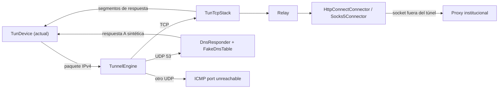

# Plan: ProxyUCI multiplataforma (Android, iOS, macOS, Windows)

Objetivo: una app que autentica contra el proxy institucional y enruta todo el tráfico del dispositivo por él,
con **un solo núcleo en Kotlin común** y adaptadores mínimos por plataforma, enlazados con Koin a través de un
módulo `expect`/`actual`. Todo el código sigue SOLID e inyección por constructor (sección 3).

Referencias de comportamiento:

- `superproxy/1/ANALISIS.md` (carpeta junto al proyecto, sin versionar): cómo lo hace Super Proxy en Android (VPN local, DNS falso, `CONNECT`).
- `superproxy/windows/src/*.cs`: port propio para Windows, con NTLMv2 y pila TCP en memoria. Es la base del
  port a Kotlin.

---

## 1. Principio de diseño

Todo lo que es *lógica* va en común. Cada plataforma solo aporta tres cosas:

1. **Abrir la interfaz TUN** y configurar dirección, rutas y DNS.
2. **Leer y escribir paquetes IP crudos** en esa interfaz.
3. **Arrancar y parar el túnel** con el mecanismo del sistema (servicio, extensión o proceso elevado).

Para que el núcleo sea idéntico en las cuatro plataformas, la captura TCP se hace con una **pila TCP en espacio
de usuario** (port de `TunTcpStack.cs`), no con el truco de NAT sobre la TUN que usa Super Proxy en Android. Así
el núcleo no depende de cómo cada kernel reinyecta paquetes.

| Capa | Dónde vive | Compartido |
|---|---|---|
| Interfaz Compose, pantallas, view models | `shared/src` | Sí |
| Modelo de perfil, estados, eventos | `core/src` | Sí |
| Parseo IP/TCP/UDP, checksums, sniffing de `Host`/SNI | `core/src` | Sí |
| Pila TCP en memoria | `core/src` | Sí |
| DNS falso | `core/src` | Sí |
| Clientes `HTTP CONNECT` (Basic, NTLMv2) y SOCKS5 | `core/src` | Sí |
| MD4, MD5, HMAC-MD5 para NTLMv2 | `core/src` | Sí |
| Motor del túnel (bucle, relé, estadísticas) | `core/src` | Sí |
| Sockets TCP/UDP salientes | `core/src` con `ktor-network` | Sí (a validar en fase 0) |
| Apertura de TUN, rutas, DNS del sistema | `core/src@<plataforma>` | No |
| Ciclo de vida del túnel y permisos | `core/src@<plataforma>` y apps | No |
| Almacenamiento seguro de la contraseña | `core/src@<plataforma>` | No |
| Modo "Otro País": reescritura del `.ovpn` y proxy local de encadenado | `core/src` | Sí |
| Modo "Otro País": localizar y lanzar `openvpn` | `core/src@jvm` | No (solo escritorio) |

---

## 2. Estructura de módulos

El proyecto usa Kotlin Toolchain (Amper 0.13.0). Hoy `shared` mezcla interfaz y lógica; se separa en dos módulos
porque la extensión de iOS no puede cargar Compose (límite de memoria, ver sección 7).

```
./                             raíz del repositorio
├── core/                      kmp/lib sin Compose: motor + adaptadores
│   ├── module.yaml            platforms: jvm, android, iosArm64, iosSimulatorArm64
│   ├── src/                   código común (todo el núcleo)
│   │   ├── model/             ProxyProfile, VpnState, TunnelStats, TunnelEvent
│   │   ├── packet/            Ipv4, Tcp, Udp, checksums, HostSniffer
│   │   ├── tcp/               TunTcpStack, TunTcpConnection
│   │   ├── dns/               FakeDnsTable, DnsResponder
│   │   ├── auth/              Md4, Md5, HmacMd5, Ntlm
│   │   ├── proxy/             ProxyConnector, HttpConnectConnector, Socks5Connector
│   │   ├── engine/            TunnelEngine, Relay
│   │   ├── ovpn/              OvpnConfigRewriter, LocalConnectProxy (modo Otro País)
│   │   ├── port/              interfaces que implementa cada plataforma
│   │   └── di/                coreModule y expect val platformModule
│   ├── src@android/           adaptadores VpnService + actual platformModule
│   ├── src@jvm/               adaptadores Wintun, utun, OpenVpnRunner + actual platformModule
│   ├── src@ios/               adaptadores NEPacketTunnelFlow + actual platformModule
│   └── test/                  pruebas comunes con dobles en memoria
├── shared/                    kmp/lib con Compose: interfaz y uiModule, depende de //core
├── androidApp/                Activity + ProxyVpnService
├── desktopApp/                ventana Compose + modo --engine elevado
└── iosApp/                    app + target PacketTunnel (extensión)
```

`jvm` es un único target para Windows y macOS. `expect`/`actual` se resuelve en compilación por target, así que
dentro de `src@jvm` la elección entre Wintun y utun se hace **en tiempo de ejecución** según `os.name`.

---

## 3. Puertos, inyección por constructor y SOLID

La inyección de dependencias es con **Koin**, siempre por constructor. Esto cambia cómo se usa
`expect`/`actual` respecto a la primera versión del plan: los adaptadores ya no son `expect class`, sino
**interfaces comunes (puertos)** con una implementación por plataforma, y el único `expect` es el módulo de Koin
que las enlaza. Una `expect class` no se puede sustituir por un doble en las pruebas y ataría el núcleo a una
clase concreta; una interfaz sí cumple la inversión de dependencias.

### Reglas

1. **Todo por constructor.** Ninguna clase pide sus dependencias: las recibe. Nada de `KoinComponent`,
   `by inject()` ni `get()` fuera de los puntos de la regla 3.
2. **El núcleo depende de interfaces.** Los puertos viven en `core/src/port`; las implementaciones de plataforma,
   en `core/src@<plataforma>`.
3. **Koin solo en la raíz de composición.** Se permite importar Koin en los paquetes `di/` y en los puntos de
   entrada que el sistema instancia y que por eso no admiten constructor propio: `Application` y
   `ProxyVpnService` en Android, la subclase de `NEPacketTunnelProvider` en iOS, `main` en escritorio, y
   `koinViewModel()` en Compose.
4. **Lo que necesita datos de ejecución lo crea una fábrica inyectada.** Una sesión de túnel (perfil, TUN) o una
   conexión TCP no se piden a Koin: las crea una clase fábrica que sí llega por constructor.
5. **Sin estado global.** Reloj, aleatoriedad y dispatchers se inyectan, lo que hace deterministas las pruebas
   de la pila TCP y de la elección de dirección de la TUN.

### Puertos (`core/src/port`)

```kotlin
interface PacketReader { suspend fun readPacket(): ByteArray? }   // null = interfaz cerrada
interface PacketWriter { suspend fun writePacket(packet: ByteArray) }
interface TunDevice : PacketReader, PacketWriter {
    val mtu: Int
    fun close()
}

data class TunConfig(
    val address: String,            // 10.A.B.C
    val virtualSubnet: String,      // 10.A.0.0/16, usada por el DNS falso
    val dnsServer: String,          // IP señuelo que el motor intercepta
    val mtu: Int,
    val proxyHost: String,          // debe quedar fuera del túnel
    val routePrivateNetworks: Boolean,
)

/** Abre la TUN y aplica dirección, rutas y DNS. Deshace todo en close(). */
interface PlatformTunnel {
    suspend fun establish(config: TunConfig): TunDevice
    fun close()
}

sealed interface ExitMode {
    data object Direct : ExitMode                                   // todas las plataformas
    data class OtherCountry(val ovpnPath: String, val ovpnUser: String) : ExitMode   // solo escritorio
}

/** Lo que la interfaz usa para mandar. */
interface TunnelControl {
    val supportedModes: Set<KClass<out ExitMode>>
    suspend fun connect(profile: ProxyProfile, mode: ExitMode)
    suspend fun disconnect()
}

/** Lo que la interfaz usa para observar. */
interface TunnelMonitor {
    val state: StateFlow<VpnState>
    val stats: StateFlow<TunnelStats>
    val events: Flow<TunnelEvent>
}

interface SecretStore {
    fun put(key: String, value: String)
    fun get(key: String): String?
    fun remove(key: String)
}

interface KeyValueStore {
    fun getString(key: String): String?
    fun putString(key: String, value: String)
}

interface Logger { fun log(level: LogLevel, tag: String, message: String) }

enum class PlatformKind { ANDROID, IOS, WINDOWS, MACOS, LINUX }

interface PlatformInfo {
    val kind: PlatformKind
    val osVersion: String
    val isDesktop: Boolean get() = kind in setOf(PlatformKind.WINDOWS, PlatformKind.MACOS, PlatformKind.LINUX)
}
```

`PlatformInfo` sustituye al `Platform`/`getPlatform()` de la plantilla. Se usa en la raíz de composición de
`jvm` y para diagnósticos y registros. No se usa para ramificar comportamiento en el núcleo ni en la interfaz:
para eso se pregunta por la capacidad, como `TunnelControl.supportedModes`.

### El único `expect`: el módulo de plataforma

```kotlin
// core/src/di/CoreModule.kt
expect val platformModule: Module

val coreModule = module {
    singleOf(::NtlmAuthenticator) bind ProxyAuthenticator::class
    singleOf(::BasicAuthenticator) bind ProxyAuthenticator::class
    singleOf(::HttpConnectConnector) bind ProxyConnector::class
    singleOf(::Socks5Connector) bind ProxyConnector::class
    // Varias implementaciones del mismo puerto: quien las consume recibe la lista completa
    single { ProxyConnectorRegistry(connectors = getAll(), authenticators = getAll()) }
    singleOf(::FakeDnsTable)
    singleOf(::TunTcpStackFactory)
    singleOf(::TunnelSessionFactory)
    singleOf(::OvpnConfigRewriter)
}

// core/src@android/di/PlatformModule.android.kt
actual val platformModule = module {
    singleOf(::AndroidSecretStore) bind SecretStore::class
    singleOf(::AndroidKeyValueStore) bind KeyValueStore::class
    singleOf(::AndroidTunnelController) { binds(listOf(TunnelControl::class, TunnelMonitor::class)) }
    singleOf(::LogcatLogger) bind Logger::class
}
```

En `jvm`, la elección entre Windows y macOS se hace en el `actual` del módulo, que es raíz de composición:
`single<PlatformTunnel> { if (get<PlatformInfo>().kind == PlatformKind.WINDOWS) WintunTunnel(get()) else UtunTunnel(get()) }`.
El resto del código no sabe en qué sistema corre.

### Implementaciones por plataforma

| Puerto | Android | iOS | JVM en Windows | JVM en macOS |
|---|---|---|---|---|
| `PlatformTunnel` | `VpnService.Builder` → descriptor de archivo | `NEPacketTunnelNetworkSettings` → `packetFlow` | `wintun.dll` por JNA, rutas con `netsh`/`route` | `utun` por JNA, `ifconfig`/`route`/`networksetup` |
| `LocalAddresses` | `NetworkInterface` | Pendiente (capa 7) | Pendiente (capa 6) | Pendiente (capa 5) |
| `TunnelControl` y `TunnelMonitor` | `Intent` a `ProxyVpnService`, permiso `VpnService.prepare()` | `NETunnelProviderManager` | Cliente IPC del proceso `--engine` elevado (UAC) | Igual, con elevación por `osascript` |
| `SecretStore` | `EncryptedSecretStore` común + clave AES-GCM en Android Keystore | Keychain; grupo compartido app/extensión a partir de la capa 7 | `EncryptedSecretStore` común + DPAPI | Llavero mediante `/usr/bin/security`, con la orden por la entrada estándar |
| `KeyValueStore` | `SharedPreferences` | `NSUserDefaults` de App Group | Archivo en `%LOCALAPPDATA%` | Archivo en `~/Library/Application Support` |
| `Logger` | Logcat | `NSLog` (válido también en la extensión) | SLF4J, con Logback en `desktopApp` | SLF4J, con Logback en `desktopApp` |
| `LocalNetworkPermission` | Pide `ACCESS_LOCAL_NETWORK` en Android 17 o superior, mediante la Activity | Sin acción: iOS muestra su propio aviso | Sin acción | Sin acción |
| `RandomBytes` | `SecureRandom` | `SecRandomCopyBytes` | `SecureRandom` | `SecureRandom` |
| `PlatformInfo` | Constante, versión de `Build.VERSION` | Constante, versión de `NSProcessInfo` (válido también en la extensión) | `os.name` en ejecución | `os.name` en ejecución |

En Android e iOS el `PlatformTunnel` necesita el objeto que crea el sistema (`VpnService`,
`NEPacketTunnelProvider`). Ese punto de entrada es raíz de composición: construye su adaptador pasándose a sí
mismo y se lo entrega a `TunnelSessionFactory`, que ya le llega resuelto por Koin.

### Raíces de composición por proceso

El túnel corre en un proceso distinto de la interfaz en iOS y en escritorio, así que cada proceso arranca su
propio Koin con los módulos que le tocan.

| Proceso | Módulos |
|---|---|
| App Android (incluye `ProxyVpnService`) | `coreModule`, `platformModule`, `uiModule` |
| App iOS | `platformModule`, `uiModule` |
| Extensión `PacketTunnel` de iOS | `coreModule`, `platformModule` (sin Compose) |
| Ventana de escritorio | `platformModule`, `uiModule` |
| Proceso `--engine` de escritorio | `coreModule`, `platformModule` |

Los `single` de Koin son perezosos: un proceso solo instancia lo que usa, aunque el módulo declare más.

### Cómo se aplica SOLID

| Principio | En este proyecto |
|---|---|
| Responsabilidad única | `LocalProxyRelay.cs` (1438 líneas) se parte en conector, autenticador, relé y proxy local. `TunnelEngine` solo reparte paquetes |
| Abierto/cerrado | Un `ProxyConnector` por protocolo, un `ProxyAuthenticator` por esquema y un `PacketHandler` por protocolo IP. Añadir SOCKS5 sobre TLS o Digest es una clase nueva más una línea en el módulo |
| Sustitución de Liskov | Una misma batería de pruebas de contrato para `TunDevice` corre contra el doble en memoria y contra cada adaptador real |
| Segregación de interfaces | `PacketReader`/`PacketWriter`, `TunnelControl`/`TunnelMonitor`, `SecretStore`/`KeyValueStore`: cada consumidor ve solo lo que usa |
| Inversión de dependencias | El núcleo define los puertos y las plataformas los implementan; ninguna clase común importa API de plataforma ni Koin |

Pruebas: los dobles se pasan por constructor, sin arrancar Koin. Además, una prueba por plataforma ejecuta
`verify()` sobre los módulos para detectar dependencias sin enlazar antes de ejecutar la app.

### Cómo evita cada plataforma el bucle (los sockets hacia el proxy no deben entrar en la TUN)

| Plataforma | Mecanismo |
|---|---|
| Android | `addDisallowedApplication(paquetePropio)`; la red `10.0.0.0/8` no se enruta |
| iOS | Los sockets de la extensión salen fuera del túnel por diseño del sistema |
| Windows y macOS | Ruta `/32` al proxy por la puerta de enlace física, como hace `VpnTunnelEngine.cs` |

Con esto los sockets salientes pueden ser comunes (`ktor-network`) sin un `protect()` por socket.

---

## 4. Núcleo común: qué se porta y de dónde

| Componente Kotlin (`core/src`) | Origen | Líneas en C# |
|---|---|---|
| `packet/*` | `PacketUtils.cs` | 428 |
| `dns/FakeDnsTable` | `PacketUtils.cs` (`FakeDnsTable`) | incluido arriba |
| `tcp/TunTcpStack` | `TunTcpStack.cs` | 1094 |
| `auth/Ntlm`, `Md4` | `NtlmAuth.cs` | 284 |
| `proxy/*`, `engine/Relay` | `LocalProxyRelay.cs` | 1438 |
| `engine/TunnelEngine` | parte de `VpnTunnelEngine.cs` (la parte de rutas va a `PlatformTunnel`) | 685 |
| `ovpn/OvpnConfigRewriter`, `ovpn/LocalConnectProxy` | `OpenVpnRunner.cs` (sanitización) y `LocalProxyRelay.cs` (puente loopback) | parte de 666 y 1438 |
| `src@jvm/OpenVpnRunner` | `OpenVpnRunner.cs` (descubrimiento y proceso hijo) | resto de 666 |
| `test/*` | `SelfTest.cs` (9 pruebas) | 578 |

No se portan `MainForm.cs`, `AppleControls.cs`, `AppleTheme.cs` ni `AppIconGenerator.cs`: la interfaz se rehace
en Compose. `ProcessTracker.cs` queda para la versión 2 y solo en escritorio.

Flujo del motor, igual en todas las plataformas:



Comportamientos que se conservan del port en C# y del análisis:

- DNS falso: cada nombre recibe una IP sintética en `10.A.0.0/16`; al conectar, la IP se traduce de vuelta al
  nombre y el `CONNECT` se hace por nombre, de modo que resuelve el proxy.
- Sniffing de `Host` y SNI cuando la app conecta por IP.
- Alternativa `.sslip.io` cuando el proxy rechaza `CONNECT` a una IP literal.
- La dirección de la TUN se elige evitando el segundo octeto de las redes `10.x` locales.
- UDP que no es DNS se rechaza con ICMP para que QUIC caiga a TCP rápido.

---

## 5. Alcance

| | Versión 1 | Versión 2 |
|---|---|---|
| Proxy | HTTP con Basic y NTLMv2, SOCKS5 | HTTPS y SOCKS5 sobre TLS |
| Tráfico | TCP sobre IPv4, DNS por el proxy | UDP por SOCKS5, DNS externos |
| Funciones | Perfiles, probar proxy, conectar, estadísticas, registro | Split tunneling, firewall por app, actividad por app |
| Solo escritorio | Modo "Otro País" con OpenVPN (Windows y macOS) | Actividad por proceso |

IPv6 queda fuera del túnel, igual que en Super Proxy. Las cuatro plataformas entran en la versión 1.

### Modo "Otro País" (escritorio)

En este modo la app no abre su propia TUN: la crea OpenVPN. El papel del núcleo es otro:

1. `LocalConnectProxy` (común) escucha en `127.0.0.1:<puerto>` y reenvía cada `CONNECT` al proxy institucional
   con NTLMv2 o Basic, usando los mismos conectores del modo Directo.
2. `OvpnConfigRewriter` (común) genera una copia temporal del `.ovpn`: `proto tcp-client`, solo remotos TCP 443,
   `http-proxy 127.0.0.1 <puerto>`, cifrados con alternativa, y credenciales en un archivo temporal que se borra
   al autenticar.
3. `OpenVpnRunner` (`src@jvm`) localiza el binario, lo lanza desde el proceso `--engine` elevado, sigue su
   salida para reportar el estado y garantiza que muere con la app.

| | Windows | macOS |
|---|---|---|
| Binario | `openvpn.exe` de ProtonVPN, OpenVPN GUI o `PATH` | `openvpn` de Homebrew o el incluido en Tunnelblick |
| Limpieza del proceso hijo | Job Object | Grupo de procesos, señal al salir |
| DNS | `block-outside-dns` | Esa opción no existe; el DNS que empuja el servidor se aplica con `networksetup` y se restaura al parar |
| Adaptador | `tap-windows6` u `ovpn-dco` | `utun`, lo crea OpenVPN |

iOS y Android no tienen este modo: no pueden lanzar un proceso `openvpn`. `supportedModes` lo oculta en la
interfaz.

---

## 6. Fases

> El orden de entrega vigente está en [`ROADMAP.md`](./ROADMAP.md), organizado por capas verticales. Las fases
> de abajo describen el trabajo técnico por bloques y sus validaciones; si el orden difiere, manda el roadmap.

Cada fase termina con algo verificable. Las fases 1 y 2 no necesitan ninguna VPN: se prueban en JVM con una TUN
falsa en memoria y un proxy falso local.

### Fase 0: validaciones previas (antes de escribir el núcleo)

| Qué validar | Por qué | Si falla |
|---|---|---|
| `ktor-network` (TCP y UDP) compila y conecta en `iosArm64` | Decide si los sockets son comunes | Añadir un puerto `SocketFactory` con implementación POSIX en iOS y NIO en JVM/Android. **Resuelto para TCP en la capa 2:** funciona en la app de iOS (simulador), tras el puerto `TcpConnector`; queda por probar dentro de la extensión y con UDP |
| Amper 0.13 puede generar el framework de `core` y enlazarlo desde un target de extensión | Sin esto no hay iOS | Añadir el target a mano en `iosApp/module.xcodeproj` (el `.pbxproj` sí está versionado) |
| El perfil de aprovisionamiento admite Network Extensions (packet tunnel), App Groups y Keychain compartido para la app y la extensión | Hay cuenta de pago; falta crear los identificadores | Ajustar identificadores y capacidades en el portal |
| JNA funciona en `jvm/app` y abre un `utun` con `sudo` en este Mac | Base del adaptador de escritorio | Probar la API FFM del JDK |
| Un `openvpn` de Homebrew conecta en este Mac a un `.ovpn` TCP 443 a través de un proxy HTTP local | Base del modo "Otro País" en macOS | Probar con el binario de Tunnelblick |

Listo cuando: las cinco respuestas están anotadas en este archivo.

### Fase 1: núcleo sin red

- Crear el módulo `core` y sustituir `Platform.kt`/`getPlatform()` de `shared` por el puerto `PlatformInfo`.
- `port`, `di` (`coreModule`, `platformModule` con dobles mínimos por plataforma) y arranque de Koin en cada app.
- `model`, `packet`, `auth`, `dns`.
- Listo cuando: pasan en común las pruebas de checksums, sniffing, DNS falso y los vectores de prueba de NTLMv2
  de la especificación MS-NLMP, y `verify()` valida los módulos de Koin en los tres targets.

### Fase 2: motor completo

- `tcp`, `proxy`, `engine`, más `FakeTunDevice` para pruebas.
- Listo cuando: una prueba JVM inyecta un SYN en la TUN falsa, el motor negocia con un proxy falso que exige
  NTLM, y los datos van y vuelven íntegros; también cierre, retransmisión y reset.

### Fase 3: Android (primer extremo a extremo)

- `actual` de Android, `ProxyVpnService` en primer plano, permisos y notificación.
- Interfaz mínima en `shared`: formulario de perfil, Probar Proxy, Conectar, estado.
- Listo cuando: en un teléfono, con el proxy real, navegan apps que no soportan proxy.

### Fase 4: macOS

- `UtunTunnel` por JNA, rutas, DNS del sistema con restauración al parar y al arrancar tras un cierre anómalo.
- Proceso `--engine` elevado más IPC local con token; la ventana Compose corre sin privilegios.
- Listo cuando: `./kotlin run -m desktopApp` conecta en este Mac y al desconectar la red queda como estaba.

### Fase 5: Windows

- `WintunTunnel` por JNA reutilizando el mismo IPC; elevación por UAC; empaquetar `wintun.dll`.
- Listo cuando: iguala al `SuperProxyWin.exe` actual en modo Directo.

### Fase 6: modo "Otro País" en escritorio

- `LocalConnectProxy` y `OvpnConfigRewriter` en común, con pruebas de reescritura sobre perfiles `.ovpn` reales.
- `OpenVpnRunner` en `src@jvm` para Windows y macOS; selector de modo de salida y credenciales OpenVPN en la
  interfaz.
- Listo cuando: en ambos sistemas, con un `.ovpn` de ProtonVPN, la IP pública vista desde fuera es la del país
  elegido, y al desconectar no queda ningún proceso `openvpn` ni DNS cambiado.

### Fase 7: iOS

- Target `PacketTunnel` con una subclase Swift mínima de `NEPacketTunnelProvider` que delega en `core`.
- `actual` de iOS; perfil por `providerConfiguration`, contraseña por Keychain compartido, estadísticas por
  `sendProviderMessage`.
- Medición de memoria de la extensión bajo carga.
- Listo cuando: conecta en un iPhone real y aguanta navegación sostenida sin que el sistema mate la extensión.

### Fase 8: endurecimiento y versión 2

- Reconexión al cambiar de red, apagado limpio, límites de conexiones, empaquetado e instaladores.
- Funciones de la versión 2 por prioridad.

---

## 7. Riesgos

| Riesgo | Impacto | Mitigación |
|---|---|---|
| Límite de memoria de la extensión de iOS. No está documentado; se reportan unos 50 MB desde iOS 15, con informes contradictorios de 15 MB | El sistema mata el túnel | `core` sin Compose, búferes acotados, tope de conexiones, medir en fase 7 |
| iOS exige dispositivo real; el simulador no ejecuta túneles | Pruebas más lentas | El `actual` de `iosSimulatorArm64` es un stub que solo permite probar la interfaz |
| "Otro País" depende de un `openvpn` instalado por el usuario y de que el `.ovpn` tenga remotos TCP 443 | El modo no arranca | Detectar el binario y validar el perfil antes de conectar, con mensaje claro |
| Diferencias de OpenVPN entre Windows y macOS (DNS, limpieza del proceso) | Fugas de DNS o procesos huérfanos | Tabla de diferencias en la sección 5; criterio de salida de la fase 6 |
| Soporte de Amper para targets de extensión, sin confirmar | Trabajo manual en Xcode | Validar en fase 0 |
| `ktor-network` en nativo: hay artefactos para iOS, pero la documentación oficial no publica una matriz de plataformas y la API es experimental | Sockets no comunes | Validar en fase 0; alternativa con un puerto `SocketFactory` |
| Koin resuelve el grafo en ejecución, no en compilación | Fallo al arrancar por una dependencia sin enlazar | Prueba `verify()` de los módulos en cada plataforma |
| Privilegios en escritorio (root en macOS, Administrador en Windows) | Fricción y superficie de seguridad | Solo el proceso `--engine` se eleva; IPC en loopback con token |
| Cierre anómalo deja rutas o DNS cambiados en escritorio | El equipo se queda sin red | Guardar el estado previo y restaurarlo al arrancar |
| La pila TCP propia es la pieza más delicada | Cuelgues, datos corruptos | Portar la versión C# ya probada y cubrirla con pruebas en fase 2 |

---

## 8. Decisiones

Tomadas (2026-11-16):

- Hay cuenta Apple Developer de pago: iOS entra en la versión 1 (fase 7).
- El modo "Otro País" con OpenVPN entra en la versión 1 de escritorio, en Windows y macOS (fase 6).

- Inyección de dependencias con Koin, siempre por constructor, y diseño según SOLID (sección 3). Los
  adaptadores pasan de `expect class` a interfaces; el único `expect` es `platformModule`.

- Firma de iOS (2026-11-16): se trabaja sin firmar, en simulador, hasta que haga falta. La firma con cuenta de
  pago, sesión iniciada en Xcode e iPhone real se retoma al llegar a la capa 7, que es la única que la exige.

Abierta:

- Nombre de paquete: el proyecto usa `org.uci.proxy`; el núcleo iría en `org.uci.proxy.core`.

---

## 9. Manifiesto de dependencias

Las versiones viven en `libs.versions.toml`. Son las últimas estables publicadas a 2026-11-16, consultadas en
Maven Central y Google Maven. El criterio es depender de lo mínimo: criptografía de NTLM, pila TCP, DNS y
parseo de paquetes son código propio en común.

### Librerías

| Dependencia | Versión | Módulo y ámbito | Para qué |
|---|---|---|---|
| `org.jetbrains.kotlinx:kotlinx-coroutines-core` | 1.11.0 | `core`, común | Bucle del motor, relés, `StateFlow` de estado |
| `io.ktor:ktor-network` | 3.6.1 | `core`, común | Sockets TCP/UDP hacia el proxy y proxy local en loopback |
| `kotlinx-serialization-json` (`$kotlin.serialization.json`) | la del toolchain | `core`, común | Perfiles, mensajes IPC, configuración de la extensión de iOS |
| `io.insert-koin:koin-core` | 4.2.2 | `core`, común | Módulos de DI (`coreModule`, `platformModule`) |
| `io.insert-koin:koin-compose` | 4.2.2 | `shared`, común | Koin en el árbol de Compose |
| `io.insert-koin:koin-compose-viewmodel` | 4.2.2 | `shared`, común | `viewModelOf` y `koinViewModel()` |
| `org.jetbrains.androidx.navigation3:navigation3-ui` | 1.2.0 | `shared`, común | Navegación entre pantallas (Navigation 3, la librería que recomienda Google, en la versión de JetBrains). Cada pantalla es una ruta serializable (`Route`) y la pila se guarda al recrear la actividad. En iOS las rutas hay que registrarlas (`routesConfiguration`) |
| `org.jetbrains.androidx.lifecycle:lifecycle-viewmodel-navigation3` | 2.11.0 | `shared`, común | Un `ViewModel` por pantalla, que se descarta al salir de ella |
| `io.insert-koin:koin-android` | 4.2.2 | `androidApp` | `androidContext()` para los adaptadores de Android |
| `io.insert-koin:koin-test` | 4.2.2 | `core` y `shared`, pruebas | `verify()` de los módulos |
| `org.slf4j:slf4j-api` | 2.0.18 | `core`, solo `jvm` | API de registro; es la versión que usa Logback 1.6.2 |
| `net.java.dev.jna:jna` | 5.19.1 | `core`, solo `jvm` | Llamar a `wintun.dll` y abrir `utun` |
| `net.java.dev.jna:jna-platform` | 5.19.1 | `core`, solo `jvm` | DPAPI y API de Windows ya mapeadas |
| `androidx.core:core-ktx` | 1.19.1 | `androidApp` | Notificación del servicio en primer plano |
| `org.jetbrains.kotlinx:kotlinx-coroutines-test` | 1.11.0 | `core`, pruebas | Pruebas del motor con tiempo virtual |
| `io.ktor:ktor-network-tls` | 3.6.1 | `core`, versión 2 | Proxies HTTPS y SOCKS5 sobre TLS |
| Compose, lifecycle, activity-compose, logback | las actuales | `shared`, apps | Ya estaban en la plantilla; no cambian |

`ktor-network` publica artefactos para `jvm`, `iosArm64` e `iosSimulatorArm64`, que son los targets del
proyecto. Que el artefacto exista no prueba que funcione dentro de la extensión; eso sigue en la fase 0.

Sin dependencia, con API del sistema: Android Keystore y `VpnService`, Keychain y NetworkExtension en iOS,
`kotlin.time` para relojes.

### `core/module.yaml`

```yaml
product:
  type: kmp/lib
  platforms: [ jvm, android, iosArm64, iosSimulatorArm64 ]

dependencies:
  - $libs.kotlinx.coroutines.core: exported
  - $libs.ktor.network
  - $kotlin.serialization.json
  - $libs.koin.core: exported

dependencies@jvm:
  - $libs.slf4j.api
  - $libs.jna
  - $libs.jna.platform

test-dependencies:
  - $libs.kotlinx.coroutines.test
  - $libs.koin.test

settings:
  kotlin:
    serialization: enabled
```

Cambios en los módulos existentes:

- `shared/module.yaml`: añadir `- //core: exported`, `- $libs.koin.compose` y
  `- $libs.koin.compose.viewmodel`; en pruebas, `- $libs.koin.test`.
- `androidApp/module.yaml`: añadir `- $libs.androidx.core.ktx` y `- $libs.koin.android`.
- `desktopApp` e `iosApp`: sin cambios; reciben `core` a través de `shared`. La extensión de iOS enlaza solo
  `core`.

### Componentes que no vienen de Maven

| Componente | Versión | Plataforma | Cómo se obtiene |
|---|---|---|---|
| `wintun.dll` (amd64 y arm64) | 0.14.1, del ZIP oficial de wintun.net, sin modificar y con su licencia | Windows | Recurso de `core` (`resources@jvm/native`); el motor la extrae y verifica su SHA-256 antes de cargarla |
| `openvpn` | 2.6 o superior | Windows y macOS, modo "Otro País" | Lo instala el usuario (ProtonVPN, OpenVPN GUI, Homebrew o Tunnelblick) |
| Xcode y perfil con Network Extensions | — | iOS | Cuenta Apple Developer |

---

## Fuentes de las validaciones pendientes

- Versiones: <https://repo1.maven.org/maven2/> y <https://dl.google.com/dl/android/maven2/>
- Sintaxis de `module.yaml` (`serialization: enabled`, `exported`): <https://kotlin-toolchain.org/dev/>

- Sockets de Ktor (API experimental, sin matriz de plataformas): <https://ktor.io/docs/server-sockets.html>
- Artefactos nativos de `ktor-network-tls`: <https://klibs.io/package/io.ktor/ktor-network-tls>
- Límite de memoria de `NEPacketTunnelProvider`: <https://developer.apple.com/forums/thread/73148>,
  <https://openradar.appspot.com/27660401>
- Configuración de Network Extensions en Xcode:
  <https://developer.apple.com/documentation/xcode/configuring-network-extensions>
