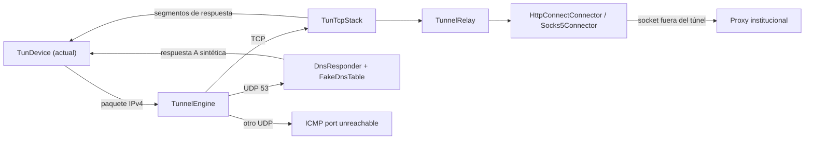

# Plan: ProxyUCI multiplataforma (Android, iOS, macOS, Windows)

Objetivo: una app que autentica contra el proxy institucional y enruta todo el tráfico del dispositivo por él,
con **un solo núcleo en Kotlin común** y adaptadores mínimos por plataforma, enlazados con Koin a través de un
módulo `expect`/`actual`. Todo el código sigue SOLID e inyección por constructor (sección 3).

Este archivo describe el diseño **tal como está en el código**. El orden de entrega y el estado de cada función están
en [`ROADMAP.md`](./ROADMAP.md).

Referencias de comportamiento:

- `superproxy/1/ANALISIS.md` (carpeta junto al proyecto, sin versionar): cómo lo hace Super Proxy en Android (VPN local, DNS falso, `CONNECT`).
- `superproxy/windows/src/*.cs`: port propio para Windows, con NTLMv2 y pila TCP en memoria. Fue la base del
  port a Kotlin.

---

## 1. Principio de diseño

Todo lo que es *lógica* va en común. Cada plataforma solo aporta tres cosas:

1. **Abrir la interfaz TUN** y configurar dirección, rutas y DNS.
2. **Leer y escribir paquetes IP crudos** en esa interfaz.
3. **Arrancar y parar el túnel** con el mecanismo del sistema (servicio, extensión o proceso elevado).

Para que el núcleo sea idéntico en las cuatro plataformas, la captura TCP se hace con una **pila TCP en espacio
de usuario** (port de `TunTcpStack.cs`), no con el truco de NAT sobre la TUN que usa Super Proxy en Android. Así
el núcleo no depende de cómo cada kernel reinyecta paquetes.

| Capa | Dónde vive | Compartido |
|---|---|---|
| Interfaz Compose, pantallas, view models | `shared/src` | Sí |
| Modelo de perfil y reglas de salida | `core/src/model` | Sí |
| Parseo IP/TCP/UDP, checksums, rutas, sniffing de `Host`/SNI | `core/src/packet` | Sí |
| Pila TCP en memoria | `core/src/tcp` | Sí |
| DNS falso | `core/src/dns` | Sí |
| Clientes `HTTP CONNECT` (Basic, NTLMv2) y SOCKS5, nombres para IP públicas | `core/src/proxy` | Sí |
| MD4, MD5, HMAC-MD5 para NTLMv2 | `core/src/auth` | Sí |
| Motor del túnel (bucle, relé, reparto por reglas, comprobaciones de conectividad) | `core/src/engine` | Sí |
| Cliente OpenVPN de «Otro País» | `core/src/vpn` | Sí; criptografía y TLS en `src@jvmAndAndroid` |
| Sockets TCP salientes | `core/src/net` con `ktor-network` | Sí |
| Registro en memoria y su guardado | `core/src/log` y módulo `database` (Room) | Sí |
| Apertura de TUN, rutas, DNS del sistema | `core/src@<plataforma>` | No |
| Ciclo de vida del túnel y permisos | `core/src@<plataforma>` y apps | No |
| Almacenamiento seguro de contraseñas y `.ovpn` | `core/src@<plataforma>` | No |

---

## 2. Estructura de módulos

El proyecto usa Kotlin Toolchain (Amper 0.13.0). La interfaz y la lógica van en módulos separados porque la
extensión de iOS no puede cargar Compose (límite de memoria, ver sección 7); por lo mismo, la base de datos va en un
módulo propio que la extensión no enlaza.

```
./                             raíz del repositorio
├── core/                      kmp/lib sin Compose: motor + adaptadores
│   ├── module.yaml            platforms: jvm, android, iosArm64, iosSimulatorArm64; alias jvmAndAndroid
│   ├── src/                   código común (todo el núcleo)
│   │   ├── model/             ProxyProfile, RoutingRules
│   │   ├── packet/            Ipv4, Tcp, Routes, HostSniffer
│   │   ├── tcp/               TunTcpStack
│   │   ├── dns/               FakeDnsTable, DnsResponder, DnsAnswers
│   │   ├── auth/              Md4/Md5/HmacMd5 (Digests), Ntlm
│   │   ├── proxy/             HttpConnectConnector, Socks5Connector, esquemas Basic/NTLM, ProxyTester, IpNamer
│   │   ├── net/               KtorTcpConnector
│   │   ├── engine/            TunnelEngine, TunnelRelay, TunnelRunner, SplitRouting, ConnectivityChecks
│   │   ├── routing/           RuleSet
│   │   ├── vpn/               CountryEngine, ProxyDialer, OpenVpnEngine (OvpnConfig, OpenVpnClient), tailscale/ (Otro País)
│   │   ├── profile/           ProfileRepository, ProfileValidator
│   │   ├── settings/          AppSettings, servicios de nombres y su estado
│   │   ├── storage/           EncryptedSecretStore
│   │   ├── log/               LogBuffer, BufferedLogger, LogRecorder
│   │   ├── port/              interfaces que implementa cada plataforma
│   │   └── di/                coreModule, tunnelModule y expect val platformModule
│   ├── src@android/           VpnService, Keystore, dueño de cada conexión + actual platformModule
│   ├── src@jvm/               utun y Wintun, motor elevado e IPC (desktop/) + actual platformModule
│   ├── src@jvmAndAndroid/     JcaOpenVpnCrypto, SslEngineTlsSession
│   ├── src@ios/               Keychain, NSUserDefaults, NSLog + actual platformModule (túnel aún no disponible)
│   └── test/                  pruebas comunes con dobles en memoria
├── database/                  kmp/lib con Room y SQLite incluido: el registro guardado (databaseModule)
├── shared/                    kmp/lib con Compose: interfaz y uiModule, depende de //core y //database
├── androidApp/                Activity, ProxyVpnService, catálogo de apps
├── desktopApp/                ventana Compose + modo --engine elevado
└── iosApp/                    app (la extensión PacketTunnel llegará con la capa 7)
```

`jvm` es un único target para Windows y macOS. `expect`/`actual` se resuelve en compilación por target, así que
la elección entre Wintun y utun se hace **en tiempo de ejecución** según `PlatformInfo.kind`, en `EngineMain`.

---

## 3. Puertos, inyección por constructor y SOLID

La inyección de dependencias es con **Koin**, siempre por constructor. Los adaptadores no son `expect class`, sino
**interfaces comunes (puertos)** con una implementación por plataforma, y el único `expect` es el módulo de Koin
que las enlaza. Una `expect class` no se puede sustituir por un doble en las pruebas y ataría el núcleo a una
clase concreta; una interfaz sí cumple la inversión de dependencias.

### Reglas

1. **Todo por constructor.** Ninguna clase pide sus dependencias: las recibe. Nada de `KoinComponent`,
   `by inject()` ni `get()` fuera de los puntos de la regla 3.
2. **El núcleo depende de interfaces.** Los puertos viven en `core/src/port`; las implementaciones de plataforma,
   en `core/src@<plataforma>`.
3. **Koin solo en la raíz de composición.** Se permite importar Koin en los paquetes `di/` y en los puntos de
   entrada que el sistema instancia y que por eso no admiten constructor propio: `Application` y
   `ProxyVpnService` en Android, la subclase de `NEPacketTunnelProvider` en iOS, `main` en escritorio, y
   `koinViewModel()` en Compose.
4. **Lo que necesita datos de ejecución lo crea una fábrica inyectada.** Una sesión de túnel (perfil, TUN) o una
   conexión TCP no se piden a Koin: las crea una clase fábrica que sí llega por constructor (`TunnelEngineFactory`).
5. **Sin estado global.** Reloj, aleatoriedad y dispatchers se inyectan, lo que hace deterministas las pruebas
   de la pila TCP y de la elección de dirección de la TUN.

### Puertos principales (`core/src/port`)

Extracto; las firmas completas y su documentación están en el código.

```kotlin
interface PacketReader { suspend fun readPacket(): ByteArray? }   // null = interfaz cerrada
fun interface PacketWriter { suspend fun writePacket(packet: ByteArray) }
interface TunDevice : PacketReader, PacketWriter { fun close() }

data class TunConfig(
    val sessionName: String,
    val address: String,              // 10.A.0.1, o la que empuja el servidor VPN
    val dnsServer: String,            // dentro de la subred virtual; lo atiende el motor
    val mtu: Int,
    val routes: List<Ipv4Route>,      // subred virtual + IPv4 público, menos los rangos directos
    val proxyAddress: String,         // debe salir por la red real
    val netmask: String = "255.255.0.0",
    val excludedApps: List<String> = emptyList(),   // solo Android: apps directas
)

fun interface PlatformTunnel { suspend fun establish(config: TunConfig): TunDevice }

sealed interface TunnelState {
    data object Disconnected : TunnelState
    data class Connecting(val profileId: String) : TunnelState
    data class Connected(val profileId: String, val vpnDown: Boolean = false) : TunnelState
    data class Failed(val failure: TunnelFailure) : TunnelState
}

/** Lo que la interfaz usa para mandar. */
interface TunnelControl {
    val isAvailable: Boolean          // false donde aún no hay túnel (iOS): la interfaz oculta «Conectar»
    suspend fun connect(profileId: String)
    suspend fun disconnect()
}

/** Lo que la interfaz usa para observar. */
interface TunnelMonitor { val state: StateFlow<TunnelState> }

interface SecretStore { fun put(key: String, value: String); fun get(key: String): String?; fun remove(key: String) }
interface KeyValueStore { fun getString(key: String): String?; fun putString(key: String, value: String); fun remove(key: String) }
interface DataProtector { fun protect(plain: ByteArray): ByteArray; fun unprotect(protectedData: ByteArray): ByteArray }

fun interface TcpConnector { suspend fun connect(host: String, port: Int): TcpConnection }
fun interface RandomBytes { fun next(size: Int): ByteArray }
fun interface LocalAddresses { /* redes 10.x locales, para no chocar con la subred virtual */ }
fun interface HostResolver { /* resuelve el proxy con el DNS real antes de levantar el túnel */ }
fun interface LocalDnsSource { suspend fun read(): LocalDnsConfig }   // servidores y dominios de búsqueda de la red real
fun interface DnsTransport { suspend fun exchange(server: String, query: ByteArray, timeoutMs: Long): ByteArray? }
fun interface ConnectionOwner { fun appsFor(protocol: Int, source: Int, sourcePort: Int, destination: Int, destinationPort: Int): List<String> }
interface LogHistory { /* registro guardado: append, latest, deleteBefore, trimTo */ }
interface Logger
interface PlatformInfo           // kind (ANDROID, IOS, WINDOWS, MACOS, LINUX) y versión
interface LocalNetworkPermission
```

`PlatformInfo` se usa en la raíz de composición de `jvm` y para diagnósticos y registros. No se usa para ramificar
comportamiento en el núcleo ni en la interfaz: para eso se pregunta por la capacidad, como `TunnelControl.isAvailable`.

### Módulos de Koin

| Módulo | Dónde | Qué enlaza |
|---|---|---|
| `platformModule` (`expect`) | `core/src@<plataforma>/di` | Dispatchers, `PlatformInfo`, `Logger` (envuelto en `BufferedLogger`), almacenes, aleatoriedad, criptografía de OpenVPN, `LocalAddresses`, `HostResolver`, y en Android `ConnectionOwner` |
| `coreModule` | `core/src/di` | Reloj, `LogBuffer`, perfiles, ajustes, estado de servicios de nombres, `KtorTcpConnector`, esquemas NTLM y Basic (NTLM primero), conectores HTTP y SOCKS5, `ProxyTester` |
| `tunnelModule` | `core/src/di` | Solo procesos que ejecutan el túnel: `TunnelStateStore` (como `TunnelMonitor`), `TunAddressPlanner`, `TunnelEngineFactory`, `ProxyDialer`, `OpenVpnEngine` y `TailscaleEngine` (en `CountryEngines`), `TunnelRunner` |
| `databaseModule` | `database/src/di` | Room, `RoomLogHistory` (como `LogHistory`) y `LogRecorder` |
| `uiModule` | `shared/src/di` | View models |
| `androidAppModule`, `desktopAppModule` | apps | El `TunnelControl` real de cada sistema (servicio de Android, cliente IPC del motor de escritorio) |

En `jvm` el `platformModule` enlaza un túnel «no disponible»; la ventana de escritorio lo sustituye por
`DesktopTunnelController`, y el proceso `--engine` construye `MacPlatformTunnel` o `WinPlatformTunnel` según el sistema.

### Implementaciones por plataforma

| Puerto | Android | iOS | JVM en Windows | JVM en macOS |
|---|---|---|---|---|
| `PlatformTunnel` | `AndroidPlatformTunnel` (`VpnService.Builder`) | Pendiente (capa 7) | `WinPlatformTunnel`: `wintun.dll` por JNA, `netsh`/`route` | `MacPlatformTunnel`: `utun` por JNA, `ifconfig`/`route`, DNS con `scutil` |
| `LocalAddresses` | `AndroidLocalAddresses` | — | `JvmLocalAddresses` | `JvmLocalAddresses` |
| `TunnelControl` y `TunnelMonitor` | `AndroidTunnelController` → `ProxyVpnService`, permiso `VpnService.prepare()` | `UnavailableTunnel` | `DesktopTunnelController`: IPC con el proceso `--engine` elevado (UAC) | Igual, con elevación por `osascript` |
| `SecretStore` | `EncryptedSecretStore` + clave AES-GCM en Android Keystore | Keychain | `EncryptedSecretStore` + DPAPI | Llavero mediante `/usr/bin/security` (valores largos por trozos) |
| `KeyValueStore` | `SharedPreferences` | `NSUserDefaults` | `settings.properties` en `%LOCALAPPDATA%\ProxyUCI` | `settings.properties` en `~/Library/Application Support/ProxyUCI` |
| `Logger` | Logcat | `NSLog` | SLF4J, con Logback en `desktopApp` | SLF4J, con Logback en `desktopApp` |
| `LocalNetworkPermission` | Pide `ACCESS_LOCAL_NETWORK` en Android 17 o superior, mediante la Activity | Concedido: iOS muestra su propio aviso | Concedido | Concedido |
| `ConnectionOwner` | `getConnectionOwnerUid` (Android 10+) | No se sabe | No se sabe | No se sabe |
| `LocalDnsSource` | `AndroidLocalDnsSource` (`LinkProperties` de la red sin VPN) | — | `WinLocalDnsSource` (PowerShell) | `MacLocalDnsSource` (`scutil`, servicio principal) |
| `OpenVpnCrypto`, `TlsSessionFactory` | JCA y `SSLEngine` (`src@jvmAndAndroid`) | «No disponible» | JCA y `SSLEngine` | JCA y `SSLEngine` |
| `RandomBytes` | `SecureRandom` | `SecRandomCopyBytes` | `SecureRandom` | `SecureRandom` |

### Raíces de composición por proceso

El túnel corre en un proceso distinto de la interfaz en escritorio (y lo hará en iOS), así que cada proceso arranca
su propio Koin con los módulos que le tocan.

| Proceso | Módulos |
|---|---|
| App Android (incluye `ProxyVpnService`) | `platformModule`, `coreModule`, `databaseModule`, `uiModule`, `tunnelModule`, `androidAppModule` |
| App iOS | `platformModule`, `coreModule`, `databaseModule`, `uiModule` |
| Extensión `PacketTunnel` de iOS (capa 7) | `platformModule`, `coreModule`, `tunnelModule` (sin Compose ni Room) |
| Ventana de escritorio | `platformModule`, `coreModule`, `databaseModule`, `uiModule`, `desktopAppModule` |
| Proceso `--engine` de escritorio | `platformModule`, `coreModule`, `tunnelModule` |

Los `single` de Koin son perezosos: un proceso solo instancia lo que usa, aunque el módulo declare más.

### Cómo se aplica SOLID

| Principio | En este proyecto |
|---|---|
| Responsabilidad única | `LocalProxyRelay.cs` (1438 líneas) se partió en conectores, esquemas de autenticación y relé. `TunnelEngine` solo reparte paquetes |
| Abierto/cerrado | Un `ProxyConnector` por protocolo y un esquema de autenticación por tipo. Añadir SOCKS5 sobre TLS o Digest es una clase nueva más una línea en el módulo |
| Sustitución de Liskov | Las pruebas de `TunDevice` corren contra el doble en memoria y, en CI, contra Wintun real |
| Segregación de interfaces | `PacketReader`/`PacketWriter`, `TunnelControl`/`TunnelMonitor`, `SecretStore`/`KeyValueStore`: cada consumidor ve solo lo que usa |
| Inversión de dependencias | El núcleo define los puertos y las plataformas los implementan; ninguna clase común importa API de plataforma ni Koin |

Pruebas: los dobles se pasan por constructor, sin arrancar Koin. Además, `verify()` comprueba los módulos para
detectar dependencias sin enlazar antes de ejecutar la app.

### Cómo evita cada plataforma el bucle (los sockets hacia el proxy no deben entrar en la TUN)

| Plataforma | Mecanismo |
|---|---|
| Android | `addDisallowedApplication(paquetePropio)` |
| iOS | Los sockets de la extensión salen fuera del túnel por diseño del sistema |
| Windows y macOS | Ruta `/32` al proxy por la puerta de enlace física, como hace `VpnTunnelEngine.cs` |

Con esto los sockets salientes son comunes (`ktor-network`) sin un `protect()` por socket.

---

## 4. Núcleo común: qué se portó y de dónde

| Componente Kotlin (`core/src`) | Origen | Líneas en C# |
|---|---|---|
| `packet/*` | `PacketUtils.cs` | 428 |
| `dns/FakeDnsTable` | `PacketUtils.cs` (`FakeDnsTable`) | incluido arriba |
| `tcp/TunTcpStack` | `TunTcpStack.cs` | 1094 |
| `auth/Ntlm`, `auth/Digests` | `NtlmAuth.cs` | 284 |
| `proxy/*`, `engine/TunnelRelay` | `LocalProxyRelay.cs` | 1438 |
| `engine/TunnelEngine`, `engine/TunnelRunner` | parte de `VpnTunnelEngine.cs` (la parte de rutas va a `PlatformTunnel`) | 685 |
| `vpn/*` | Nuevo: cliente OpenVPN propio (no viene de `OpenVpnRunner.cs`, que lanzaba un `openvpn` externo) | — |
| `test/*` | `SelfTest.cs` (9 pruebas), muy ampliado | 578 |

No se portan `MainForm.cs`, `AppleControls.cs`, `AppleTheme.cs`, `AppIconGenerator.cs` ni `OpenVpnRunner.cs`: la
interfaz se rehízo en Compose y Otro País tiene su propio cliente. `ProcessTracker.cs` (reglas por proceso en
escritorio) queda para después de la versión 1.

Flujo del motor, igual en todas las plataformas:



Con reglas de salida, `SplitRouting` se coloca delante: decide por cada conexión si va al relé (proxy), a la VPN de
Otro País (también UDP), sale directa o se bloquea (ROADMAP, capa 11).

Comportamientos que se conservan del port en C# y del análisis:

- DNS falso: cada nombre recibe una IP sintética en `10.A.0.0/16`; al conectar, la IP se traduce de vuelta al
  nombre y el `CONNECT` se hace por nombre, de modo que resuelve el proxy.
- Sniffing de `Host` y SNI cuando la app conecta por IP.
- IP públicas por nombre: se piden al proxy primero por un servicio como `sslip.io` (configurable en Ajustes,
  `IpNamer`) y la IP tal cual como último recurso, porque el Squid de la UCI rechaza IP literales.
- La dirección de la TUN se elige evitando el segundo octeto de las redes `10.x` locales.
- UDP que no es DNS se rechaza con ICMP para que QUIC caiga a TCP rápido.
- Las comprobaciones de conectividad del sistema (Android, Windows, macOS) se contestan en local
  (`ConnectivityChecks`), con un ajuste para desactivarlo.

---

## 5. Alcance

| | Versión 1 | Después |
|---|---|---|
| Proxy | HTTP con Basic y NTLMv2, SOCKS5 | HTTPS y SOCKS5 sobre TLS |
| Tráfico | TCP sobre IPv4, DNS por el proxy | UDP por SOCKS5, HTTP en claro para Squid que rechaza `CONNECT` al 80 |
| Funciones | Perfiles, probar proxy, conectar, registro, Otro País, reglas de salida por sitio y por app (Android) | Reglas por app en escritorio, actividad por app, contadores de tráfico |

IPv6 queda fuera del túnel, igual que en Super Proxy. Las cuatro plataformas entran en la versión 1.

### Modo «Otro País» (macOS, Windows y Android)

Es opcional por perfil, con un motor a elegir: OpenVPN o Tailscale. El túnel solo habla con un `CountryEngine`, que abre
a través del proxy una `VpnSession` de paquetes con su `VpnNetwork` (dirección, prefijo, DNS, MTU); `ProxyDialer` es la
forma común de llegar a un servidor por el proxy. Tailscale (librería oficial embebida por JNI, `tools/tsbridge`) se
describe en la capa 12 del [`ROADMAP.md`](./ROADMAP.md). Con OpenVPN, la app es también el cliente: no lanza ningún
programa externo.

```
Apps → interfaz TUN de Proxy → [cifrado OpenVPN] → conexión TCP al servidor VPN (abierta con CONNECT por el proxy)
```

1. `OvpnConfig` (común) lee el `.ovpn`: servidores TCP, la autoridad `<ca>` y la clave `<tls-crypt>`. Lo que el cliente
   no implementa se rechaza al cargar.
2. `OpenVpnClient` (común) hace el handshake: envoltura `tls-crypt`, canal de control con acuses, TLS dentro de los
   paquetes de control (puerto `TlsSession`), intercambio «key method 2» con usuario y contraseña, derivación de claves
   con el PRF de TLS 1.0 y canal de datos con AES-GCM. Las primitivas de criptografía y el TLS los aporta cada
   plataforma (`OpenVpnCrypto`, `TlsSessionFactory`); escritorio y Android comparten la implementación Java con el
   alias `jvmAndAndroid`, e iOS enlaza versiones «no disponible».
3. `OpenVpnEngine` abre la sesión probando los servidores del archivo, cada uno con el `ProxyDialer` (un `CONNECT` al
   proxy, por nombre `sslip.io` si el `.ovpn` da una IP).
4. Sin reglas de salida, `TunnelRunner` crea la interfaz **después** del handshake, con la dirección, la máscara, el DNS
   y el MTU de la `VpnNetwork` del motor, y pasa los paquetes IPv4 tal cual entre la interfaz y la VPN. Con reglas, la
   interfaz es la del modo directo y la VPN se abre a la vez, supervisada y con reintentos.

El motor, su configuración y sus secretos viajan de la ventana al motor en la orden de arranque
(`EngineStart.countryExit`), porque el motor de escritorio corre en otro proceso. iOS no tiene este modo y la interfaz oculta la sección.

---

## 6. Fases (histórico)

> Este fue el plan técnico inicial, antes de pasar a capas verticales. Se conserva como referencia de las validaciones;
> el orden y el estado vigentes están en [`ROADMAP.md`](./ROADMAP.md). La fase 6 se resolvió de otra forma: cliente
> OpenVPN propio en vez de `openvpn` externo, y también en Android.

### Fase 0: validaciones previas

| Qué validar | Resultado |
|---|---|
| `ktor-network` compila y conecta en `iosArm64` | **TCP resuelto en la capa 2:** funciona en la app de iOS (simulador), tras el puerto `TcpConnector`. Falta dentro de la extensión |
| Amper 0.13 puede enlazar `core` desde un target de extensión de iOS | Pendiente (capa 7). Alternativa: añadir el target a mano en `iosApp/module.xcodeproj` |
| Perfil de aprovisionamiento con Network Extensions, App Groups y Keychain compartido | Pendiente (capa 7) |
| JNA abre un `utun` como root en macOS | Resuelto en la capa 5 |
| Un `openvpn` externo a través del proxy | Descartado: se escribió el cliente propio (capa 9) |

### Fases 1 a 8

1. **Núcleo sin red:** `core`, `PlatformInfo`, puertos, Koin, `model`, `packet`, `auth`, `dns`. Hecho (capas 0 a 2).
2. **Motor completo:** `tcp`, `proxy`, `engine` con TUN y proxy falsos. Hecho (capa 4).
3. **Android extremo a extremo.** Hecho (capas 3 y 4); falta el proxy real de la UCI y un teléfono físico.
4. **macOS:** `utun`, rutas, DNS con `scutil`, motor elevado con IPC y token. Hecho (capa 5).
5. **Windows:** Wintun, UAC, `wintun.dll` empaquetada. Hecho en CI (capa 6).
6. **Otro País:** hecho con cliente propio en Android, macOS y Windows (capa 9).
7. **iOS:** extensión `PacketTunnel`, Keychain compartido, memoria bajo carga. Pendiente (capa 7).
8. **Endurecimiento:** reconexión, apagado limpio, límites, instaladores. Parcial: hay APK, `.exe` y `.dmg` (ver
   [`PUBLICAR.md`](./PUBLICAR.md)); la capa 10 sigue pendiente.

---

## 7. Riesgos

| Riesgo | Impacto | Mitigación |
|---|---|---|
| Límite de memoria de la extensión de iOS. No está documentado; se reportan unos 50 MB desde iOS 15, con informes contradictorios de 15 MB | El sistema mata el túnel | `core` sin Compose ni Room, búferes acotados, tope de conexiones, medir en la capa 7 |
| iOS exige dispositivo real; el simulador no ejecuta túneles | Pruebas más lentas | En el simulador el túnel es `UnavailableTunnel` y solo se prueba la interfaz |
| El cliente OpenVPN propio solo cubre TCP, `tls-crypt`, usuario y contraseña y AES-GCM | `.ovpn` que no conectan | Se rechazan al cargar con mensaje claro; pruebas contra el `openvpn` oficial en CI |
| Soporte de Amper para targets de extensión, sin confirmar | Trabajo manual en Xcode | Validar en la capa 7 |
| `ktor-network` en nativo: API experimental, sin matriz oficial de plataformas | Sockets no comunes | Funciona en la app de iOS; alternativa con implementación propia de `TcpConnector` |
| Koin resuelve el grafo en ejecución, no en compilación | Fallo al arrancar por una dependencia sin enlazar | Prueba `verify()` de los módulos |
| Privilegios en escritorio (root en macOS, Administrador en Windows) | Fricción y superficie de seguridad | Solo el proceso `--engine` se eleva; IPC en loopback con token en archivo privado |
| Cierre anómalo deja rutas o DNS cambiados en escritorio | El equipo se queda sin red | El motor retira al arrancar el resolvedor de `scutil` que quedara; restauración completa en la capa 10 |
| La pila TCP propia es la pieza más delicada | Cuelgues, datos corruptos | Port de la versión C# ya probada, con pruebas de tiempo virtual |

---

## 8. Decisiones

Tomadas:

- (2026-11-16) Hay cuenta Apple Developer de pago: iOS entra en la versión 1 (capa 7). Se trabaja sin firmar, en
  simulador, hasta llegar a esa capa.
- (2026-11-16) Inyección de dependencias con Koin, siempre por constructor, y diseño según SOLID (sección 3). Los
  adaptadores son interfaces; el único `expect` es `platformModule`.
- (2026-11-16) Paquete `org.uci.proxy`; el núcleo en `org.uci.proxy.core` y la base de datos en `org.uci.proxy.database`.
- Otro País con un cliente OpenVPN propio dentro de la app, en Android, macOS y Windows, en vez de lanzar un
  `openvpn` instalado aparte (capa 9).
- Registro guardado con Room en un módulo aparte de `core`, para que la extensión de iOS no cargue SQLite. Los secretos
  siguen en `SecretStore`.

---

## 9. Manifiesto de dependencias

Las versiones viven en `libs.versions.toml`. El criterio es depender de lo mínimo: criptografía de NTLM, pila TCP, DNS,
parseo de paquetes y el cliente OpenVPN son código propio en común.

### Librerías

| Dependencia | Versión | Módulo y ámbito | Para qué |
|---|---|---|---|
| `org.jetbrains.kotlinx:kotlinx-coroutines-core` | 1.11.0 | `core`, común | Bucle del motor, relés, `StateFlow` de estado |
| `io.ktor:ktor-network` | 3.6.1 | `core`, común | Sockets TCP hacia el proxy |
| `kotlinx-serialization-json` (`$kotlin.serialization.json`) | la del toolchain | `core` y `shared`, común | Perfiles, mensajes IPC, rutas de navegación |
| `io.insert-koin:koin-core` | 4.2.2 | `core`, común | Módulos de DI |
| `io.insert-koin:koin-compose`, `koin-compose-viewmodel` | 4.2.2 | `shared`, común | Koin en Compose, `koinViewModel()` |
| `io.insert-koin:koin-android` | 4.2.2 | `androidApp` | `androidContext()` para los adaptadores de Android |
| `io.insert-koin:koin-test` | 4.2.2 | `core` y `shared`, pruebas | `verify()` de los módulos |
| `org.jetbrains.androidx.navigation3:navigation3-ui` | 1.2.0 | `shared`, común | Navegación entre pantallas; cada pantalla es una ruta serializable y la pila se guarda al recrear la actividad. En iOS las rutas hay que registrarlas |
| `org.jetbrains.androidx.lifecycle:lifecycle-viewmodel-navigation3` | 2.11.0 | `shared`, común | Un `ViewModel` por pantalla, que se descarta al salir de ella |
| `org.jetbrains.kotlinx:kotlinx-datetime` | 0.7.1 | `shared`, común | Horas del registro |
| `androidx.room:room-runtime` y `room-compiler` (KSP) | 2.8.5 | `database` | Registro guardado |
| `androidx.sqlite:sqlite-bundled` | 2.6.2 | `database` | SQLite incluido, igual en todas las plataformas |
| `org.slf4j:slf4j-api` | 2.0.19 | `core`, solo `jvm` | API de registro; es la que trae `ktor-network` |
| `net.java.dev.jna:jna`, `jna-platform` | 5.19.1 | `core`, solo `jvm` | `wintun.dll`, `utun` y DPAPI |
| `androidx.core:core-ktx` | 1.19.1 | `androidApp` | Notificación del servicio en primer plano |
| `org.jetbrains.kotlinx:kotlinx-coroutines-test` | 1.11.0 | pruebas | Pruebas del motor con tiempo virtual |
| `io.ktor:ktor-network-tls` | 3.6.1 | declarada, sin usar | Proxies HTTPS y SOCKS5 sobre TLS, más adelante |
| Compose, lifecycle, activity-compose, logback | ver `libs.versions.toml` | `shared`, apps | Interfaz y registro en escritorio |

Sin dependencia, con API del sistema: Android Keystore y `VpnService`, Keychain en iOS, JCA y `SSLEngine` para
OpenVPN en JVM y Android, `kotlin.time` para relojes.

### Componentes que no vienen de Maven

| Componente | Versión | Plataforma | Cómo se obtiene |
|---|---|---|---|
| `wintun.dll` (amd64 y arm64) | 0.14.1, del ZIP oficial de wintun.net, sin modificar y con su licencia | Windows | Recurso de `core` (`resources@jvm/native`); el motor la extrae y verifica su SHA-256 antes de cargarla |
| Xcode y perfil con Network Extensions | — | iOS | Cuenta Apple Developer |

---

## Fuentes de las validaciones pendientes

- Versiones: <https://repo1.maven.org/maven2/> y <https://dl.google.com/dl/android/maven2/>
- Sintaxis de `module.yaml` (`serialization: enabled`, `exported`, `aliases`): <https://kotlin-toolchain.org/dev/>
- Sockets de Ktor (API experimental, sin matriz de plataformas): <https://ktor.io/docs/server-sockets.html>
- Límite de memoria de `NEPacketTunnelProvider`: <https://developer.apple.com/forums/thread/73148>,
  <https://openradar.appspot.com/27660401>
- Configuración de Network Extensions en Xcode:
  <https://developer.apple.com/documentation/xcode/configuring-network-extensions>
