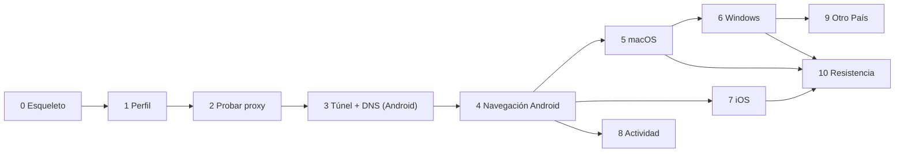

# Roadmap: ProxyUCI por capas verticales

Cada capa vertical entrega **algo que una persona puede usar**, atravesando interfaz, núcleo, adaptador de
plataforma e inyección. Ninguna capa construye una pieza "para más adelante": el núcleo crece solo con lo que la
capa en curso necesita.

El diseño (puertos, módulos, reglas de Koin y SOLID) está en [`PLAN.md`](./PLAN.md). Este archivo fija **el
orden de entrega**.

---

## Vista general

| # | Capa vertical | Lo que se puede hacer al terminar | Android | iOS | macOS | Windows |
|---|---|---|---|---|---|---|
| 0 | Esqueleto andante | Abrir la app y ver en qué plataforma corre | ✔ | ✔ | ✔ | ✔ |
| 1 | Perfil de proxy | Crear, editar y guardar un perfil con su contraseña | ✔ | ✔ | ✔ | ✔ |
| 2 | Probar proxy | Pulsar "Probar proxy" y saber si las credenciales valen | ✔ | ✔ | ✔ | ✔ |
| 3 | Túnel con DNS en Android | Conectar y que los nombres resuelvan | ✔ | | | |
| 4 | Navegación en Android | Navegar con cualquier app por el proxy | ✔ | | | |
| 5 | Navegación en macOS | Lo mismo en el Mac | | | ✔ | |
| 6 | Navegación en Windows | Lo mismo en el PC | | | | ✔ |
| 7 | Navegación en iOS | Lo mismo en el iPhone | | ✔ | | |
| 8 | Actividad | Ver tráfico, estado y registro de eventos | ✔ | ✔ | ✔ | ✔ |
| 9 | Otro País | Salir por un `.ovpn` encadenado al proxy | | | ✔ | ✔ |
| 10 | Resistencia | Cambiar de red o cerrar mal sin quedarse sin Internet | ✔ | ✔ | ✔ | ✔ |

Las capas 0 a 2 no necesitan ninguna VPN y corren en las cuatro plataformas. Sirven para dejar probados
Koin, el almacenamiento, los sockets y NTLMv2 antes de tocar una interfaz TUN.



---

## Definición de terminado (vale para todas las capas)

- La función se demuestra en un dispositivo o equipo real de cada plataforma marcada.
- Toda clase nueva recibe sus dependencias por constructor; Koin solo aparece en `di/` y en puntos de entrada.
- La prueba `verify()` de los módulos de Koin pasa en los tres targets.
- La lógica nueva del núcleo tiene pruebas comunes con dobles en memoria.
- `./kotlin build` y `./kotlin test` pasan.

---

## Capa 0: esqueleto andante

> **Estado: terminada el 2026-11-16**, salvo la comprobación en Windows. Verificado: `./kotlin build` y
> `./kotlin test` pasan en JVM, Android e iOS (simulador); la app muestra su plataforma en este Mac, en un
> emulador Android y en un simulador de iPhone. Pendiente: abrirla en un PC con Windows.
>
> Para ejecutar: `./kotlin run -m desktopApp --no-compose-hot-reload` (sin esa opción descarga un runtime de
> 240 MB para la recarga en caliente), `./kotlin run -m androidApp -d <id>` y
> `./kotlin run -m iosApp -p iosSimulatorArm64 -d <id>`.

**Resultado:** la app arranca en las cuatro plataformas y muestra "ProxyUCI en \<plataforma\> \<versión\>",
dato que llega por inyección desde el adaptador de cada una.

| Parte | Trabajo |
|---|---|
| Interfaz | Pantalla inicial con un view model que recibe `PlatformInfo` |
| Núcleo | Módulo `core` nuevo; puertos `PlatformInfo` y `Logger` |
| Adaptadores | `AndroidPlatformInfo`, `IosPlatformInfo`, `JvmPlatformInfo` y un `Logger` por plataforma |
| Inyección | `coreModule`, `expect val platformModule`, `uiModule`; arranque de Koin en cada app |

**Validaciones que resuelve:** Koin y el catálogo de dependencias compilan con Amper en `jvm`, `android`,
`iosArm64` e `iosSimulatorArm64`.

**Demo:** captura de la misma pantalla en teléfono Android, iPhone, Mac y PC.

## Capa 1: perfil de proxy

> **Estado: terminada el 2026-11-16 en Android, iOS y macOS; falta Windows.** Verificado con flujos de
> Maestro en emulador Android y simulador iOS: crear un perfil, cerrar la app, reabrirla, editarlo (la
> contraseña vuelve del almacén seguro) y eliminarlo. En Android la contraseña queda cifrada en disco.
> `./kotlin test` pasa en los tres targets.
>
> En macOS se recorrió lo mismo en la app de escritorio, manejando la ventana por accesibilidad con
> `orca computer`: el perfil queda en `~/Library/Application Support/ProxyUCI/settings.properties` sin la
> contraseña, esta va al llavero, ambos sobreviven a reiniciar la app y se borran al eliminar el perfil.
>
> Pendiente: Windows. El cifrado DPAPI no se ha ejecutado nunca.
>
> El llavero de iOS no se puede probar desde `./kotlin test`: el ejecutable de pruebas no es una app y recibe
> `errSecMissingEntitlement`; y si se firma a mano con permisos de llavero, el simulador se niega a lanzarlo
> ("Security policy issue"). Se comprueba con la app instalada, mediante los flujos de `maestro/`:
>
> ```bash
> maestro --device <id> test maestro/perfil-android.yaml
> maestro --device <id> test maestro/perfil-ios.yaml
> ```
>
> Ambos borran los datos de la app al empezar.

**Resultado:** se puede crear un perfil (servidor, puerto, protocolo, usuario, contraseña), cerrarlo y
encontrarlo al volver a abrir la app.

| Parte | Trabajo |
|---|---|
| Interfaz | Formulario de perfil con validación y lista de perfiles |
| Núcleo | `ProxyProfile`, `ProfileRepository` (serializa a JSON); puertos `KeyValueStore` y `SecretStore` |
| Adaptadores | Keystore, Keychain, DPAPI y almacenamiento de preferencias de cada plataforma |
| Inyección | Enlaces de los dos almacenes en cada `platformModule` |

**Demo:** guardar un perfil, matar la app, reabrir y verlo. La contraseña no aparece en claro en disco.

## Capa 2: probar proxy

> **Estado: terminada el 2026-11-16 en Android, iOS y macOS contra un proxy de pruebas; falta el proxy real de
> la UCI y probar en Windows.**
>
> Verificado:
> - `./kotlin test` pasa en los tres targets. MD4, MD5, HMAC-MD5 y NTLMv2 cumplen los vectores de las RFC
>   1320, 1321 y 2202 y de MS-NLMP 4.2.4, comprobados además con OpenSSL.
> - Con sockets reales, en emulador Android y simulador iOS (`maestro/probar-proxy-*.yaml`): NTLMv2 y Basic
>   con contraseña correcta y equivocada, y puerto sin servicio.
> - En JVM, la misma pila real contra el proxy de pruebas da los mismos cinco resultados.
> - En la app de escritorio en macOS, manejando la ventana por accesibilidad (`orca computer`, en segundo
>   plano): probar con NTLMv2 con contraseña correcta y equivocada.
>
> El proxy de pruebas es `tools/test_proxy.py`. Su verificación de NTLMv2 es independiente de la de la app y
> está contrastada con `curl --proxy-ntlm`.
>
> Pendiente:
> - **Proxy real de la UCI.** Sin acceso a esa red no se puede probar. El único punto dudoso es el dominio: si
>   el usuario no lo escribe, se usa el que anuncia el proxy en su desafío, mientras que `SuperProxyWin` usaba
>   "UCI" fijo. Si fallara, basta escribir el usuario como `UCI\usuario`.
> - Windows: no se ha ejecutado nada de esta capa allí.
> - SOCKS5 solo está probado contra un servidor simulado, no contra uno real.
>
> Hallazgos que cambiaron el diseño:
> - **Android 17 bloquea la red local.** Con `targetSdk` 37 la app necesita el permiso en ejecución
>   `ACCESS_LOCAL_NETWORK`; sin él la conexión se queda colgada hasta agotar el tiempo. Hay un puerto nuevo,
>   `LocalNetworkPermission`, que también hará falta antes de levantar el túnel (capa 3).
> - **Conectar bloquea el hilo.** En Android lanzaba `NetworkOnMainThreadException`; la conexión se hace en
>   el dispatcher de entrada/salida, que ahora aporta cada `platformModule` porque `Dispatchers.IO` no existe
>   en el código común.
> - **`ktor-network` funciona en iOS** dentro de la app. Dentro de la extensión de red sigue sin probar.

**Resultado:** el botón "Probar proxy" conecta con el proxy real y responde: correcto, credenciales rechazadas
(407), o proxy inalcanzable.

| Parte | Trabajo |
|---|---|
| Interfaz | Botón y resultado en el formulario |
| Núcleo | `ProxyConnector` (`HttpConnectConnector`, `Socks5Connector`), `ProxyAuthenticator` (Basic, NTLMv2), `Md4`, `Md5`, `HmacMd5`, `ProxyTester` |
| Adaptadores | Ninguno nuevo si `ktor-network` funciona en iOS; si no, puerto `SocketFactory` |
| Inyección | Registro de conectores y autenticadores en `coreModule` |

**Validaciones que resuelve:** sockets comunes con `ktor-network` en un iPhone real, y NTLMv2 contra el proxy
institucional.

**Pruebas:** vectores de NTLMv2 de MS-NLMP; un proxy falso en memoria que exige Basic y NTLM.

**Demo:** con credenciales buenas y malas, en las cuatro plataformas.

## Capa 3: túnel con DNS en Android

> **Estado: terminada el 2026-11-16 en el emulador de Android 17.** Verificado:
> - `./kotlin test` (462 pruebas) y `./kotlin build` pasan en los tres targets.
> - Al pulsar «Conectar» Android pide autorizar la VPN, la app pasa a «Conectado», aparece la interfaz
>   `tun0` con dirección `10.A.0.1/32` y ruta `10.A.0.0/16`, y la notificación del servicio.
> - Desde fuera de la app (`adb shell ping -c 1 <nombre>`) cualquier nombre resuelve a una dirección
>   `10.A.1.x`, y el mismo nombre siempre a la misma. El registro muestra consultas de otras apps del sistema.
> - Al desconectar desaparecen la interfaz, la notificación y el servicio, y la resolución vuelve a ser la
>   normal. Conectar de nuevo funciona.
>
> Flujos: `maestro/tunel-android.yaml` y `maestro/tunel-android-desconectar.yaml`. El emulador tiene que
> tener la pantalla encendida (`adb shell input keyevent KEYCODE_WAKEUP`).
>
> Límites de esta capa, a propósito:
> - **Solo responde DNS.** El tráfico TCP todavía no entra en el túnel: solo se enruta la subred virtual.
>   Con el túnel activo las apps resuelven a direcciones inventadas y no pueden conectar; es lo esperado
>   hasta la capa 4.
> - En iOS y escritorio no hay túnel: `TunnelControl.isAvailable` es falso y la lista no muestra «Conectar».
>   Comprobado a la vista en macOS (por accesibilidad) y en el simulador de iOS: solo aparecen «Editar» y
>   «Eliminar». El botón llegará a macOS en la capa 5 y a iOS en la 7.
> - Sin probar: revocar la VPN desde los ajustes del sistema, y un dispositivo real.
>
> Dos fallos de capas anteriores que salieron al probar esta en macOS e iOS, ya corregidos:
> - **El editor se cerraba solo tras guardar** (capa 1). El view model del formulario se reutiliza y
>   conservaba la marca de «guardado», así que la siguiente apertura se cerraba al instante. Los flujos de
>   Maestro no lo veían porque reiniciaban la app entre guardar y editar; ahora editan justo después.
> - **«Guardar» quedaba bajo el teclado en iOS** (capa 2, al añadir «Probar proxy»). El formulario respeta
>   ahora el espacio del teclado y se puede desplazar hasta el botón.
>
> Decisiones tomadas al implementar:
> - El servicio en primer plano usa el tipo `systemExempted`, el que Android reserva para apps de VPN.
> - La propia app queda fuera del túnel (`addDisallowedApplication`), para que sus conexiones al proxy
>   salgan por la red real sin tener que proteger cada socket.
> - El servicio de VPN vive en `androidApp` y solo traduce órdenes; la lógica está en `TunnelRunner`, común.
> - Lo que solo necesita un proceso que ejecuta túneles está en un módulo de Koin aparte, `tunnelModule`.

**Resultado:** al pulsar "Conectar" Android pide permiso de VPN, aparece la llave en la barra de estado, la app
muestra "Conectado" y un `nslookup` desde otra app devuelve una IP de la subred virtual.

| Parte | Trabajo |
|---|---|
| Interfaz | Botón Conectar/Desconectar y estado, con `TunnelControl` y `TunnelMonitor` |
| Núcleo | `packet` (IPv4, UDP, checksums), `FakeDnsTable`, `DnsResponder`, `TunnelEngine` con `PacketHandler` de DNS, `TunnelSessionFactory` |
| Adaptadores | `AndroidPlatformTunnel` (`VpnService.Builder`), `ProxyVpnService` en primer plano, `AndroidTunnelController` |
| Inyección | Enlaces de túnel y control en el `platformModule` de Android |

**Pruebas:** batería de contrato de `TunDevice` con el doble en memoria; DNS falso de ida y vuelta.

**Demo:** conectar, consultar un nombre, desconectar; la red vuelve a su estado normal.

## Capa 4: navegación en Android

**Resultado:** con el túnel activo, apps que no soportan proxy (mensajería, tiendas, navegador) funcionan a
través del proxy institucional.

| Parte | Trabajo |
|---|---|
| Interfaz | Mensajes de error del túnel (proxy rechaza, sin red) |
| Núcleo | `TunTcpStack` y `TunTcpConnection` (port de `TunTcpStack.cs`), `Relay`, sniffing de `Host`/SNI, alternativa `.sslip.io`, rechazo de UDP con ICMP |
| Adaptadores | Ninguno nuevo |
| Inyección | `TunTcpStackFactory` y el `PacketHandler` de TCP |

**Pruebas:** en JVM, un SYN inyectado en la TUN falsa llega a un proxy falso con NTLM y los datos vuelven
íntegros; cierre, retransmisión y reset.

**Demo:** navegar y descargar un archivo grande en el teléfono con el proxy real. Es el primer extremo a
extremo completo; a partir de aquí el núcleo ya no cambia para las demás plataformas.

## Capa 5: navegación en macOS

**Resultado:** lo mismo que la capa 4 en el Mac: la app pide la contraseña de administrador, conecta y todo el
tráfico sale por el proxy.

| Parte | Trabajo |
|---|---|
| Interfaz | La misma; aviso de elevación de privilegios |
| Núcleo | Protocolo IPC entre ventana y motor (mensajes serializados) |
| Adaptadores | `UtunTunnel` por JNA, rutas y DNS del sistema con restauración, proceso `--engine` elevado, cliente IPC como `TunnelControl`/`TunnelMonitor` |
| Inyección | `platformModule` de `jvm` con selección por `PlatformInfo` |

**Validaciones que resuelve:** JNA dentro de `jvm/app` y apertura de `utun` como root.

**Pruebas:** la batería de contrato de `TunDevice` contra `UtunTunnel`.

**Demo:** `./kotlin run -m desktopApp`, conectar, navegar, desconectar; rutas y DNS quedan como estaban.

## Capa 6: navegación en Windows

**Resultado:** lo mismo en Windows, igualando al `SuperProxyWin.exe` actual en modo Directo.

| Parte | Trabajo |
|---|---|
| Interfaz | La misma |
| Núcleo | Sin cambios |
| Adaptadores | `WintunTunnel` por JNA, rutas con `netsh`/`route`, elevación por UAC, `wintun.dll` empaquetado |
| Inyección | Rama de Windows en el `platformModule` de `jvm` |

**Pruebas:** la batería de contrato de `TunDevice` contra `WintunTunnel`.

**Demo:** conectar y navegar en un PC con el proxy real.

## Capa 7: navegación en iOS

**Resultado:** lo mismo en un iPhone: iOS pide permiso para añadir la configuración VPN, conecta y las apps
navegan por el proxy.

| Parte | Trabajo |
|---|---|
| Interfaz | La misma |
| Núcleo | Sin cambios; revisión de límites de búfer y de conexiones para la extensión |
| Adaptadores | Target `PacketTunnel` con subclase Swift mínima, `IosPlatformTunnel` sobre `packetFlow`, `IosTunnelController` con `NETunnelProviderManager`, Keychain y App Group compartidos |
| Inyección | Koin propio en la extensión con `coreModule` y `platformModule`, sin Compose |

**Validaciones que resuelve:** soporte de Amper para el target de extensión, perfil de aprovisionamiento con
Network Extensions, y memoria de la extensión bajo carga.

**Demo:** navegación sostenida en un iPhone real sin que el sistema mate la extensión. No se puede demostrar en
el simulador.

## Capa 8: actividad

**Resultado:** una pestaña "Actividad" muestra bytes subidos y bajados en vivo y un registro de eventos
(conexiones, DNS, errores), en las cuatro plataformas.

| Parte | Trabajo |
|---|---|
| Interfaz | Pestaña Actividad con contadores y lista de eventos |
| Núcleo | `TunnelStats`, `TunnelEvent`, emisión desde motor, DNS y relé |
| Adaptadores | Transporte de estadísticas entre procesos: IPC en escritorio, `sendProviderMessage` en iOS |
| Inyección | Sin enlaces nuevos; se amplía `TunnelMonitor` |

**Demo:** descargar un archivo y ver los contadores moverse en cada plataforma.

## Capa 9: Otro País (escritorio)

**Resultado:** en macOS y Windows se elige el modo "Otro País", se selecciona un `.ovpn` con sus credenciales, y
la IP pública pasa a ser la del país elegido, todo encadenado a través del proxy institucional.

| Parte | Trabajo |
|---|---|
| Interfaz | Selector de modo de salida (solo si `supportedModes` lo incluye), selector de archivo y credenciales OpenVPN |
| Núcleo | `LocalConnectProxy`, `OvpnConfigRewriter`, `ExitMode.OtherCountry` |
| Adaptadores | `OpenVpnRunner` en `src@jvm`: localizar el binario, lanzarlo desde el motor elevado, limpieza del proceso y DNS por sistema |
| Inyección | Enlaces en el `platformModule` de `jvm`; móvil no declara el modo |

**Validaciones que resuelve:** `openvpn` de Homebrew conectando por un proxy HTTP local en macOS.

**Pruebas:** reescritura sobre perfiles `.ovpn` reales; proxy local contra el proxy falso con NTLM.

**Demo:** con un `.ovpn` de ProtonVPN en ambos sistemas; al desconectar no queda ningún proceso `openvpn` ni DNS
cambiado.

## Capa 10: resistencia

**Resultado:** la conexión sobrevive a un cambio de Wi-Fi, y un cierre anómalo no deja el equipo sin red.

| Parte | Trabajo |
|---|---|
| Interfaz | Estados "Reconectando" y errores recuperables |
| Núcleo | Política de reconexión, límites de conexiones, apagado ordenado |
| Adaptadores | Aviso de cambio de red por plataforma; restauración de rutas y DNS al arrancar en escritorio |
| Inyección | Puerto `NetworkMonitor` y sus implementaciones |

**Demo:** cambiar de red con el túnel activo; matar el proceso del motor en escritorio y comprobar que la red
se recupera al reabrir la app.

---

## Después de la versión 1

Cada una es una capa vertical independiente, por prioridad a decidir:

| Capa | Resultado |
|---|---|
| Proxies con TLS | Perfiles HTTPS y SOCKS5 sobre TLS, con fijación de certificado |
| UDP por SOCKS5 | Llamadas y juegos con un proxy `socks5udp` |
| Split tunneling | Elegir qué apps pasan por el túnel |
| Firewall por app | Bloquear apps concretas |
| Actividad por app | Ver qué app genera cada conexión |
| Empaquetado | Instaladores firmados para escritorio y publicación en tiendas |
