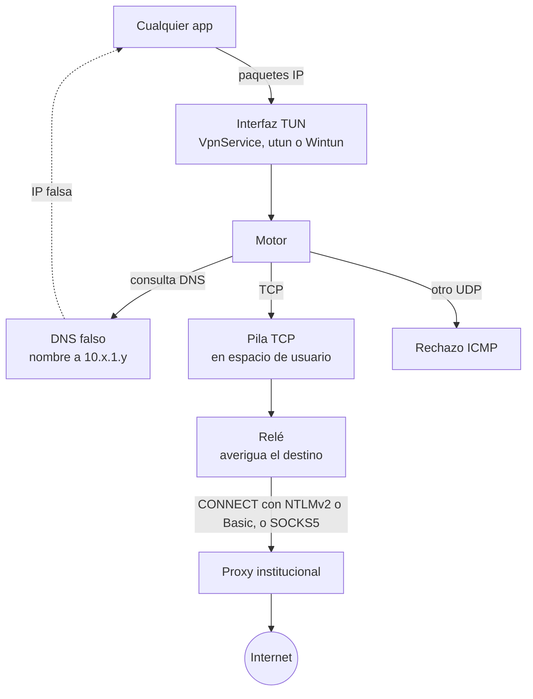

# ProxyUCI

Se autentica contra un proxy institucional (HTTP con NTLMv2 o Basic, o SOCKS5) y manda todo el tráfico del dispositivo
por él, con una VPN local. Está hecho en Kotlin Multiplatform para Android, macOS, Windows e iOS.

Funciona en Android, macOS y Windows. En iOS solo están los perfiles y «Probar proxy»; el túnel falta.

## Cómo funciona



La app abre conexiones como siempre y el sistema las manda a la interfaz TUN. El motor lee los paquetes: contesta él
mismo las consultas DNS con una dirección falsa por cada nombre, y termina las conexiones TCP con su propia pila. El
relé sabe a qué nombre iba cada conexión por esa dirección falsa (o, si la app usó una IP directa, por el SNI o el
`Host`) y abre el túnel hacia ese destino a través del proxy, autenticándose.

Un perfil puede salir además por **Otro País**: un `.ovpn` cuyo servidor se alcanza a través del mismo proxy, con un
cliente OpenVPN propio, sin nada que instalar. Con **reglas de salida** cada sitio (dominio, IP o rango) o app de Android
elige por dónde sale: el proxy, Otro País, directo o bloqueado. Si Otro País se cae, lo suyo sale por el proxy y se
avisa. Los detalles están en las capas 9 y 11 del [ROADMAP](ROADMAP.md).

En el escritorio la ventana no tiene privilegios: lanza el motor, que sí puede crear la interfaz, con el diálogo de
administrador de macOS o el aviso de UAC de Windows, y habla con él por un socket local.

## Descargas

En [Releases](https://github.com/drewdev02/Proxy/releases) hay un APK, un `.exe` para Windows de 64 bits y un `.dmg`
para Apple Silicon. El `.exe` y el `.dmg` no están firmados, así que Windows y macOS avisarán al abrirlos. En el
escritorio, conectar pide permisos de administrador.

## Compilar

```sh
./kotlin build
./kotlin test
./kotlin run -m desktopApp --no-compose-hot-reload
```

La primera vez descarga el toolchain y el JDK que necesita. Para Android e iOS: `./kotlin run -m androidApp` y
`./kotlin run -m iosApp -p iosSimulatorArm64 -d <simulador>`.

## Código

`core` es el motor, sin Compose; `shared` es la interfaz; `androidApp`, `desktopApp` e `iosApp` son los puntos de entrada.
El diseño está en [PLAN.md](PLAN.md), el estado por capas en [ROADMAP.md](ROADMAP.md) y cómo se publica una versión en
[PUBLICAR.md](PUBLICAR.md).
