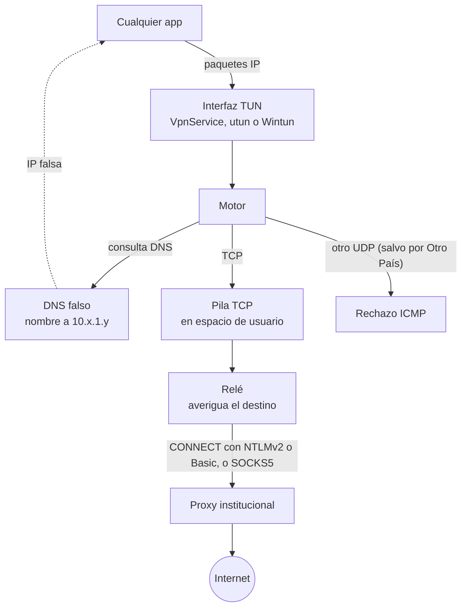

# ProxyUCI

Se autentica contra un proxy institucional (HTTP con NTLMv2 o Basic, o SOCKS5) y manda todo el tráfico del dispositivo
por él, con una VPN local. Está hecho en Kotlin Multiplatform para Android, macOS, Windows e iOS.

Funciona en Android, macOS y Windows. En iOS solo están los perfiles y «Probar proxy»; el túnel falta.

## Cómo funciona



La app abre conexiones como siempre y el sistema las manda a la interfaz TUN. El motor lee los paquetes: contesta él
mismo las consultas DNS con una dirección falsa por cada nombre, y termina las conexiones TCP con su propia pila. El
relé sabe a qué nombre iba cada conexión por esa dirección falsa (o, si la app usó una IP directa, por el SNI o el
`Host`) y abre el túnel hacia ese destino a través del proxy, autenticándose.

Un perfil puede salir además por **Otro País**, con el motor que se elija, siempre a través del mismo proxy y sin
nada que instalar: **OpenVPN** (un `.ovpn`, con un cliente propio) o **Tailscale** (un nodo de salida de una red de
Tailscale o de un servidor Headscale, con la librería oficial de Tailscale embebida). Con **reglas de salida** cada sitio
(dominio, IP o rango) o app de Android elige por dónde sale: el proxy, Otro País, directo o bloqueado. Si Otro País se
cae, lo suyo sale por el proxy y se avisa. Los detalles están en las capas 9, 11 y 12 del [ROADMAP](ROADMAP.md).

En el escritorio la ventana no tiene privilegios: lanza el motor, que sí puede crear la interfaz, con el diálogo de
administrador de macOS o el aviso de UAC de Windows, y habla con él por un socket local.

## Descargas

En [Releases](https://github.com/drewdev02/Proxy/releases) hay un APK, un `.exe` para Windows de 64 bits y un `.dmg`
para Apple Silicon. El `.exe` y el `.dmg` no están firmados, así que Windows y macOS avisarán al abrirlos. En el
escritorio, conectar pide permisos de administrador.

## Compilar

```sh
./kotlin build
./kotlin test
./kotlin run -m desktopApp --no-compose-hot-reload
```

La primera vez descarga el toolchain y el JDK que necesita. El motor Tailscale necesita además su librería nativa, que
se compila con Go (y un JDK para `jni.h`); sin ella la app funciona igual, pero no ofrece Tailscale:

```sh
tools/tsbridge/build.sh                 # la del equipo actual (escritorio y pruebas)
tools/tsbridge/build.sh android-arm64   # y android-x86_64, con el NDK de Android
tools/tsbridge/build.sh testnet         # la red de Tailscale de pruebas
```

Para Android e iOS: `./kotlin run -m androidApp` y
`./kotlin run -m iosApp -p iosSimulatorArm64 -d <simulador>`.

## Código

`core` es el motor, sin Compose; `database` guarda el registro con Room; `shared` es la interfaz; `androidApp`,
`desktopApp` e `iosApp` son los puntos de entrada.
El diseño está en [PLAN.md](PLAN.md), el estado por capas en [ROADMAP.md](ROADMAP.md) y cómo se publica una versión en
[PUBLICAR.md](PUBLICAR.md).

## Idiomas

La app está en español (por defecto) y en inglés; se elige en Ajustes > Idioma o, desde Android 13, en los ajustes del
sistema. Los textos están en los recursos de Compose Multiplatform, como recomienda
[la guía de JetBrains](https://kotlinlang.org/docs/multiplatform/compose-localize-strings.html):

- `shared/composeResources/values/strings_<pantalla>.xml` en español y `values-en/` con las mismas claves en inglés. En
  la interfaz, `stringResource(Res.string.…)`; fuera de Compose, `getString(…)`.
- `core` no escribe textos para la persona: devuelve tipos (`TunnelFailure`, `OvpnConfigError`…) y
  `shared/src/common/FailureMessages.kt` elige el texto de cada uno. Los detalles técnicos (una línea HTTP, un error del
  sistema) y los mensajes del registro no se traducen.
- Las notificaciones de Android están en `androidApp/res/values*/strings.xml` y el permiso de red local de iOS en
  `iosApp/src/*.lproj/InfoPlist.strings`.
- `TranslationsTest` falla si a un idioma le falta una clave o un hueco (`%1$s`). Las capturas de referencia se dibujan
  siempre en español.

Para añadir un idioma: una carpeta `values-xx` en `shared/composeResources` y en `androidApp/res`, una línea en
`androidApp/res/xml/locales_config.xml`, otra en `CFBundleLocalizations` de `iosApp/src/Info.plist` con su `xx.lproj`, y
una entrada en `AppLanguage`.
