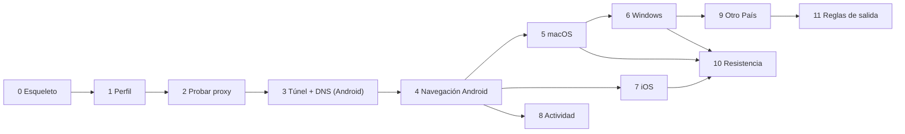

# Roadmap: ProxyUCI por capas verticales

Cada capa vertical entrega **algo que una persona puede usar**, atravesando interfaz, núcleo, adaptador de
plataforma e inyección. Ninguna capa construye una pieza "para más adelante": el núcleo crece solo con lo que la
capa en curso necesita.

El diseño (puertos, módulos, reglas de Koin y SOLID) está en [`PLAN.md`](./PLAN.md). Este archivo fija **el
orden de entrega**.

---

## Vista general

| # | Capa vertical | Lo que se puede hacer al terminar | Android | iOS | macOS | Windows |
|---|---|---|---|---|---|---|
| 0 | Esqueleto andante | Abrir la app y ver en qué plataforma corre | ✔ | ✔ | ✔ | ✔ |
| 1 | Perfil de proxy | Crear, editar y guardar un perfil con su contraseña | ✔ | ✔ | ✔ | ✔ |
| 2 | Probar proxy | Pulsar "Probar proxy" y saber si las credenciales valen | ✔ | ✔ | ✔ | ✔ |
| 3 | Túnel con DNS en Android | Conectar y que los nombres resuelvan | ✔ | | | |
| 4 | Navegación en Android | Navegar con cualquier app por el proxy | ✔ | | | |
| 5 | Navegación en macOS | Lo mismo en el Mac | | | ✔ | |
| 6 | Navegación en Windows | Lo mismo en el PC | | | | ✔ |
| 7 | Navegación en iOS | Lo mismo en el iPhone | | ✔ | | |
| 8 | Actividad | Ver tráfico, estado y registro de eventos | ✔ | ✔ | ✔ | ✔ |
| 9 | Otro País | Salir por un `.ovpn` encadenado al proxy, opcional por perfil | ✔ | | ✔ | ✔ |
| 10 | Resistencia | Cambiar de red o cerrar mal sin quedarse sin Internet | ✔ | ✔ | ✔ | ✔ |
| 11 | Reglas de salida | Elegir por sitio o por app si sale por el proxy, por Otro País, directo o se bloquea | ✔ | | ✔ | ✔ |

Las capas 0 a 2 no necesitan ninguna VPN y corren en las cuatro plataformas. Sirven para dejar probados
Koin, el almacenamiento, los sockets y NTLMv2 antes de tocar una interfaz TUN.



---

## Definición de terminado (vale para todas las capas)

- La función se demuestra en un dispositivo o equipo real de cada plataforma marcada.
- Toda clase nueva recibe sus dependencias por constructor; Koin solo aparece en `di/` y en puntos de entrada.
- La prueba `verify()` de los módulos de Koin pasa en los tres targets.
- La lógica nueva del núcleo tiene pruebas comunes con dobles en memoria.
- `./kotlin build` y `./kotlin test` pasan.

---

## Capa 0: esqueleto andante

> **Estado: terminada el 2026-11-16**, salvo la comprobación en Windows. Verificado: `./kotlin build` y
> `./kotlin test` pasan en JVM, Android e iOS (simulador); la app muestra su plataforma en este Mac, en un
> emulador Android y en un simulador de iPhone. Pendiente: abrirla en un PC con Windows.
>
> Para ejecutar: `./kotlin run -m desktopApp --no-compose-hot-reload` (sin esa opción descarga un runtime de
> 240 MB para la recarga en caliente), `./kotlin run -m androidApp -d <id>` y
> `./kotlin run -m iosApp -p iosSimulatorArm64 -d <id>`.

**Resultado:** la app arranca en las cuatro plataformas y muestra "ProxyUCI en \<plataforma\> \<versión\>",
dato que llega por inyección desde el adaptador de cada una.

| Parte | Trabajo |
|---|---|
| Interfaz | Pantalla inicial con un view model que recibe `PlatformInfo` |
| Núcleo | Módulo `core` nuevo; puertos `PlatformInfo` y `Logger` |
| Adaptadores | `AndroidPlatformInfo`, `IosPlatformInfo`, `JvmPlatformInfo` y un `Logger` por plataforma |
| Inyección | `coreModule`, `expect val platformModule`, `uiModule`; arranque de Koin en cada app |

**Validaciones que resuelve:** Koin y el catálogo de dependencias compilan con Amper en `jvm`, `android`,
`iosArm64` e `iosSimulatorArm64`.

**Demo:** captura de la misma pantalla en teléfono Android, iPhone, Mac y PC.

## Capa 1: perfil de proxy

> **Estado: terminada el 2026-11-16 en Android, iOS y macOS; falta Windows.** Verificado con flujos de
> Maestro en emulador Android y simulador iOS: crear un perfil, cerrar la app, reabrirla, editarlo (la
> contraseña vuelve del almacén seguro) y eliminarlo. En Android la contraseña queda cifrada en disco.
> `./kotlin test` pasa en los tres targets.
>
> En macOS se recorrió lo mismo en la app de escritorio, manejando la ventana por accesibilidad con
> `orca computer`: el perfil queda en `~/Library/Application Support/ProxyUCI/settings.properties` sin la
> contraseña, esta va al llavero, ambos sobreviven a reiniciar la app y se borran al eliminar el perfil.
>
> Pendiente: Windows. El cifrado DPAPI no se ha ejecutado nunca.
>
> El llavero de iOS no se puede probar desde `./kotlin test`: el ejecutable de pruebas no es una app y recibe
> `errSecMissingEntitlement`; y si se firma a mano con permisos de llavero, el simulador se niega a lanzarlo
> ("Security policy issue"). Se comprueba con la app instalada, mediante los flujos de `maestro/`:
>
> ```bash
> maestro --device <id> test maestro/perfil-android.yaml
> maestro --device <id> test maestro/perfil-ios.yaml
> ```
>
> Ambos borran los datos de la app al empezar.

**Resultado:** se puede crear un perfil (servidor, puerto, protocolo, usuario, contraseña), cerrarlo y
encontrarlo al volver a abrir la app.

| Parte | Trabajo |
|---|---|
| Interfaz | Formulario de perfil con validación y lista de perfiles |
| Núcleo | `ProxyProfile`, `ProfileRepository` (serializa a JSON); puertos `KeyValueStore` y `SecretStore` |
| Adaptadores | Keystore, Keychain, DPAPI y almacenamiento de preferencias de cada plataforma |
| Inyección | Enlaces de los dos almacenes en cada `platformModule` |

**Demo:** guardar un perfil, matar la app, reabrir y verlo. La contraseña no aparece en claro en disco.

## Capa 2: probar proxy

> **Estado: terminada el 2026-11-16 en Android, iOS y macOS contra un proxy de pruebas; falta el proxy real de
> la UCI y probar en Windows.**
>
> Verificado:
> - `./kotlin test` pasa en los tres targets. MD4, MD5, HMAC-MD5 y NTLMv2 cumplen los vectores de las RFC
>   1320, 1321 y 2202 y de MS-NLMP 4.2.4, comprobados además con OpenSSL.
> - Con sockets reales, en emulador Android y simulador iOS (`maestro/probar-proxy-*.yaml`): NTLMv2 y Basic
>   con contraseña correcta y equivocada, y puerto sin servicio.
> - En JVM, la misma pila real contra el proxy de pruebas da los mismos cinco resultados.
> - En la app de escritorio en macOS, manejando la ventana por accesibilidad (`orca computer`, en segundo
>   plano): probar con NTLMv2 con contraseña correcta y equivocada.
>
> El proxy de pruebas es `tools/test_proxy.py`. Su verificación de NTLMv2 es independiente de la de la app y
> está contrastada con `curl --proxy-ntlm`.
>
> Pendiente:
> - **Proxy real de la UCI.** Sin acceso a esa red no se puede probar. El único punto dudoso es el dominio: si
>   el usuario no lo escribe, se usa el que anuncia el proxy en su desafío, mientras que `SuperProxyWin` usaba
>   "UCI" fijo. Si fallara, basta escribir el usuario como `UCI\usuario`.
> - Windows: no se ha ejecutado nada de esta capa allí.
> - SOCKS5 solo está probado contra un servidor simulado, no contra uno real.
>
> Hallazgos que cambiaron el diseño:
> - **Android 17 bloquea la red local.** Con `targetSdk` 37 la app necesita el permiso en ejecución
>   `ACCESS_LOCAL_NETWORK`; sin él la conexión se queda colgada hasta agotar el tiempo. Hay un puerto nuevo,
>   `LocalNetworkPermission`, que también hará falta antes de levantar el túnel (capa 3).
> - **Conectar bloquea el hilo.** En Android lanzaba `NetworkOnMainThreadException`; la conexión se hace en
>   el dispatcher de entrada/salida, que ahora aporta cada `platformModule` porque `Dispatchers.IO` no existe
>   en el código común.
> - **`ktor-network` funciona en iOS** dentro de la app. Dentro de la extensión de red sigue sin probar.

**Resultado:** el botón "Probar proxy" conecta con el proxy real y responde: correcto, credenciales rechazadas
(407), o proxy inalcanzable.

| Parte | Trabajo |
|---|---|
| Interfaz | Botón y resultado en el formulario |
| Núcleo | `ProxyConnector` (`HttpConnectConnector`, `Socks5Connector`), `ProxyAuthenticator` (Basic, NTLMv2), `Md4`, `Md5`, `HmacMd5`, `ProxyTester` |
| Adaptadores | Ninguno nuevo si `ktor-network` funciona en iOS; si no, puerto `SocketFactory` |
| Inyección | Registro de conectores y autenticadores en `coreModule` |

**Validaciones que resuelve:** sockets comunes con `ktor-network` en un iPhone real, y NTLMv2 contra el proxy
institucional.

**Pruebas:** vectores de NTLMv2 de MS-NLMP; un proxy falso en memoria que exige Basic y NTLM.

**Demo:** con credenciales buenas y malas, en las cuatro plataformas.

## Capa 3: túnel con DNS en Android

> **Estado: terminada el 2026-11-16 en el emulador de Android 17.** Verificado:
> - `./kotlin test` (462 pruebas) y `./kotlin build` pasan en los tres targets.
> - Al pulsar «Conectar» Android pide autorizar la VPN, la app pasa a «Conectado», aparece la interfaz
>   `tun0` con dirección `10.A.0.1/32` y ruta `10.A.0.0/16`, y la notificación del servicio.
> - Desde fuera de la app (`adb shell ping -c 1 <nombre>`) cualquier nombre resuelve a una dirección
>   `10.A.1.x`, y el mismo nombre siempre a la misma. El registro muestra consultas de otras apps del sistema.
> - Al desconectar desaparecen la interfaz, la notificación y el servicio, y la resolución vuelve a ser la
>   normal. Conectar de nuevo funciona.
>
> Flujos: `maestro/tunel-android.yaml` y `maestro/tunel-android-desconectar.yaml`. El emulador tiene que
> tener la pantalla encendida (`adb shell input keyevent KEYCODE_WAKEUP`).
>
> Límites de esta capa, a propósito:
> - **Solo responde DNS.** El tráfico TCP todavía no entra en el túnel: solo se enruta la subred virtual.
>   Con el túnel activo las apps resuelven a direcciones inventadas y no pueden conectar; es lo esperado
>   hasta la capa 4.
> - En iOS y escritorio no hay túnel: `TunnelControl.isAvailable` es falso y la lista no muestra «Conectar».
>   Comprobado a la vista en macOS (por accesibilidad) y en el simulador de iOS: solo aparecen «Editar» y
>   «Eliminar». El botón llegará a macOS en la capa 5 y a iOS en la 7.
> - Sin probar: revocar la VPN desde los ajustes del sistema, y un dispositivo real.
>
> Dos fallos de capas anteriores que salieron al probar esta en macOS e iOS, ya corregidos:
> - **El editor se cerraba solo tras guardar** (capa 1). El view model del formulario se reutiliza y
>   conservaba la marca de «guardado», así que la siguiente apertura se cerraba al instante. Los flujos de
>   Maestro no lo veían porque reiniciaban la app entre guardar y editar; ahora editan justo después.
> - **«Guardar» quedaba bajo el teclado en iOS** (capa 2, al añadir «Probar proxy»). El formulario respeta
>   ahora el espacio del teclado y se puede desplazar hasta el botón.
>
> Decisiones tomadas al implementar:
> - El servicio en primer plano usa el tipo `systemExempted`, el que Android reserva para apps de VPN.
> - La propia app queda fuera del túnel (`addDisallowedApplication`), para que sus conexiones al proxy
>   salgan por la red real sin tener que proteger cada socket.
> - El servicio de VPN vive en `androidApp` y solo traduce órdenes; la lógica está en `TunnelRunner`, común.
> - Lo que solo necesita un proceso que ejecuta túneles está en un módulo de Koin aparte, `tunnelModule`.

**Resultado:** al pulsar "Conectar" Android pide permiso de VPN, aparece la llave en la barra de estado, la app
muestra "Conectado" y un `nslookup` desde otra app devuelve una IP de la subred virtual.

| Parte | Trabajo |
|---|---|
| Interfaz | Botón Conectar/Desconectar y estado, con `TunnelControl` y `TunnelMonitor` |
| Núcleo | `packet` (IPv4, UDP, checksums), `FakeDnsTable`, `DnsResponder`, `TunnelEngine` con `PacketHandler` de DNS, `TunnelSessionFactory` |
| Adaptadores | `AndroidPlatformTunnel` (`VpnService.Builder`), `ProxyVpnService` en primer plano, `AndroidTunnelController` |
| Inyección | Enlaces de túnel y control en el `platformModule` de Android |

**Pruebas:** batería de contrato de `TunDevice` con el doble en memoria; DNS falso de ida y vuelta.

**Demo:** conectar, consultar un nombre, desconectar; la red vuelve a su estado normal.

## Capa 4: navegación en Android

> **Estado: terminada el 2026-11-16 en el emulador de Android 17, contra el proxy de pruebas con NTLM y
> salida real a Internet.** Verificado:
> - `./kotlin test` (660 pruebas) y `./kotlin build` pasan en los tres targets. La pila TCP se prueba con
>   un cliente simulado y tiempo virtual: saludo, datos en ambos sentidos, segmentos duplicados, solapados y
>   desordenados, ventana cerrada, retransmisión, cierres, RST y desbordamiento de números de secuencia.
> - Chrome carga `https://example.com` por el túnel y el proxy registra `CONNECT example.com:443`
>   (`maestro/navegar-android.yaml`).
> - Desde la shell del dispositivo, una petición HTTP a `example.com` devuelve `200` pasando por el proxy.
> - Una descarga de 5 MB por el túnel llega con el mismo SHA-256 que el original; cinco a la vez, también.
> - El tráfico propio de Android (comprobación de conectividad, servicios de Google) sale por el proxy.
> - Al desconectar no quedan interfaz ni servicio, y no hay errores en el registro.
> - iOS (simulador) y macOS siguen funcionando igual; allí esta capa no añade nada visible.
>
> Rendimiento medido: 1,7 MB/s en la descarga de 5 MB dentro del emulador. Es modesto y esperable: la pila
> no usa escalado de ventana (tope de 64 KB por conexión) y protege todo su estado con un solo candado.
>
> Sin probar:
> - **El proxy real de la UCI** y un dispositivo físico.
> - **SOCKS5** como transporte del túnel (solo el conector, contra un servidor simulado).
> - Sesiones largas, cambios de red y uso sostenido de memoria.
>
> Diferencias con `SuperProxyWin` que quedan pendientes, porque afectan sobre todo a la UCI:
> - **HTTP en claro por el puerto 80.** Aquí todo va por `CONNECT`. `SuperProxyWin` reenviaba el puerto 80
>   como petición de proxy normal porque el Squid de la UCI rechaza `CONNECT` a ese puerto. Hasta
>   portarlo, las páginas `http://` fallarían allí. El proxy de pruebas sí acepta `CONNECT` al 80.
> - **Atajos para Telegram** (no inspeccionar sus IP, cortar rápido el puerto 80): no portados.
>
> Sí portado: el recurso a `sslip.io` para IP públicas. Al principio se usaba solo si el proxy rechazaba la IP
> escrita tal cual; desde la rc5 se pide siempre primero por nombre, como SuperProxy, porque el Squid de la UCI
> rechaza las IP literales (ver capa 9, «Servicios de nombres configurables»).
>
> Añadido después (rc3): el túnel contesta en local las comprobaciones de conectividad de Android, Windows y macOS
> (`ConnectivityChecks`): el proxy institucional suele bloquearlas (403, 503) y el sistema mostraba «sin Internet»
> aunque el tráfico pasara. Solo contesta si el proxy ha abierto conexiones hace poco, para no ocultar un proxy caído
> o una contraseña mala. Se desactiva en Ajustes.
>
> Cierre a medias: si una app cierra su envío antes de recibir la respuesta, el relé se lo transmite al
> proxy, como hacía `SuperProxyWin`. Funciona con el proxy de pruebas; falta ver cómo lo trata Squid.

**Resultado:** con el túnel activo, apps que no soportan proxy (mensajería, tiendas, navegador) funcionan a
través del proxy institucional.

| Parte | Trabajo |
|---|---|
| Interfaz | Mensajes de error del túnel (proxy rechaza, sin red) |
| Núcleo | `TunTcpStack` y `TunTcpConnection` (port de `TunTcpStack.cs`), `Relay`, sniffing de `Host`/SNI, alternativa `.sslip.io`, rechazo de UDP con ICMP |
| Adaptadores | Ninguno nuevo |
| Inyección | `TunTcpStackFactory` y el `PacketHandler` de TCP |

**Pruebas:** en JVM, un SYN inyectado en la TUN falsa llega a un proxy falso con NTLM y los datos vuelven
íntegros; cierre, retransmisión y reset.

**Demo:** navegar y descargar un archivo grande en el teléfono con el proxy real. Es el primer extremo a
extremo completo; a partir de aquí el núcleo ya no cambia para las demás plataformas.

## Capa 5: navegación en macOS

> **Estado al 2026-11-16: el túnel funciona en macOS para el tráfico TCP y la captura de todo el DNS
> funciona cuando no hay otra VPN de túnel completo. Con otra VPN así conectada (Tailscale con nodo de
> salida), su DNS le gana al nuestro. Verificado en este Mac; falta el proxy real de la UCI.**
>
> Hecho y verificado en este Mac, como root mediante el diálogo de administrador:
> - La ventana lanza el motor con privilegios, este crea la interfaz `utun` y ambos se hablan por un socket
>   local con token. Al desconectar no quedan interfaz, rutas, proceso root ni archivo de token.
> - Prueba acotada (solo la dirección de `example.com`): HTTP y HTTPS devuelven `200` por el túnel y el
>   proxy registra los `CONNECT`; el resto de la red no se ve afectado.
> - Prueba completa (todo el IPv4 público, tope de 60 s): `example.com` por HTTP y HTTPS devuelve `200`, y
>   el proxy registra conexiones del sistema y de otras apps (`api.anthropic.com`, Google, Apple).
> - `./kotlin test` y `./kotlin build` pasan; hay una prueba de integración ventana-motor por socket real.
>
> **Captura de DNS.** Desviar al túnel las rutas hacia los servidores DNS no basta: en este Mac el
> resolvedor está ligado a una interfaz (`if_index`, la de Tailscale) y sus consultas ignoran la tabla de
> rutas. Por eso el motor publica con `scutil` un resolvedor propio en
> `State:/Network/Service/ProxyUCI/DNS` y lo retira al cerrar (y al arrancar, por si quedó de antes).
> - **Por dominio, verificado** (`--dns-domains sslip.io`): los nombres de ese dominio resuelven a
>   direcciones `10.A.1.x` del túnel, una descarga de 5 MB por nombre llega íntegra y el resto de nombres
>   sigue con el DNS real. Al desconectar la clave desaparece.
> - **Todos los dominios, verificado sin otra VPN** (Tailscale apagado): un nombre inventado y
>   `example.org` resuelven a direcciones `10.A.1.x`, `curl` conecta a esas direcciones, HTTPS a
>   `example.com` y `www.apple.com` devuelve `200` por el proxy y la descarga de 5 MB por nombre llega
>   íntegra. Al desconectar, la clave desaparece y el DNS real vuelve a responder.
> - **Con otra VPN de túnel completo, no captura.** Con Tailscale y nodo de salida, nuestro resolvedor
>   aparece el primero en `scutil --dns` y responde a `dig @10.A.0.2`, pero el sistema sigue preguntando a
>   Tailscale: los dos atienden «todos los dominios» y gana el de orden más bajo (Tailscale `100600`, el
>   nuestro `102200`). Ese orden lo calcula macOS según el rango del servicio de red; añadir `SearchOrder`
>   a la clave no lo cambia (probado). En ese caso el tráfico entra igual en el túnel por su IP y el nombre
>   se saca del SNI o de `Host`.
> - Pasada final de la prueba completa, sin Tailscale: DNS capturado, HTTPS a `example.com` y
>   `www.apple.com` y HTTP a `example.org` con `200`, descarga de 5 MB íntegra, 32 conexiones por el proxy
>   y ninguna rechazada; al desconectar no queda nada.
> - Los servidores DNS de la red **no** se desvían al túnel con rutas (antes sí): el resolvedor propio basta,
>   y en muchas redes ese servidor es la puerta de enlace.
> - Las pasadas anteriores daban «tiempo agotado» en algunas conexiones. Era el proxy de pruebas: hace su
>   propia consulta DNS por UDP y no reintentaba, y la red (un punto de acceso móvil) pierde paquetes.
>   `tools/test_proxy.py` ahora reintenta; con la red de pruebas conviene `--dns 1.1.1.1`.
>
> Otras cosas pendientes o dudosas:
> - Las peticiones a `www.apple.com` fallan a ratos en este Mac también sin el túnel (salida por Tailscale);
>   el fallo suelto visto en la prueba completa no es del túnel.
> - Al conectar y desconectar se cortan las conexiones TCP abiertas del equipo (la pila responde con RST a
>   las que no conoce); se reconectan solas.
> - Cada conexión pide la contraseña de administrador. (Al principio el motor root se ejecutaba desde las
>   carpetas de compilación; ahora se distribuye dentro de `ProxyUCI.app` en el `.dmg`, ver `PUBLICAR.md`.)
>
> Opciones de prueba del motor, por la variable `PROXYUCI_ENGINE_FLAGS`: `--max-seconds N`,
> `--no-dns-capture`, `--dns-domains a,b`, `--routes cidr,cidr`, `--log-file ruta`. El proxy de pruebas, en la misma máquina,
> necesita `--bind-interface <interfaz de salida>`.

**Resultado:** lo mismo que la capa 4 en el Mac: la app pide la contraseña de administrador, conecta y todo el
tráfico sale por el proxy.

| Parte | Trabajo |
|---|---|
| Interfaz | La misma; aviso de elevación de privilegios |
| Núcleo | Protocolo IPC entre ventana y motor (mensajes serializados) |
| Adaptadores | `UtunTunnel` por JNA, rutas y DNS del sistema con restauración, proceso `--engine` elevado, cliente IPC como `TunnelControl`/`TunnelMonitor` |
| Inyección | `platformModule` de `jvm` con selección por `PlatformInfo` |

**Validaciones que resuelve:** JNA dentro de `jvm/app` y apertura de `utun` como root.

**Pruebas:** la batería de contrato de `TunDevice` contra `UtunTunnel`.

**Demo:** `./kotlin run -m desktopApp`, conectar, navegar, desconectar; rutas y DNS quedan como estaban.

## Capa 6: navegación en Windows

**Resultado:** lo mismo en Windows, igualando al `SuperProxyWin.exe` actual en modo Directo, y entregado como
**un solo `.exe`** que se autoextrae (JRE recortado, JAR y `wintun.dll` comprimidos dentro; la primera vez
descomprime en una carpeta de caché y las siguientes arranca directo).

> **Estado al 2026-11-17: el túnel funciona en un Windows real (ejecutor de GitHub Actions) con el adaptador
> Wintun de verdad, y hay un `ProxyUCI.exe` de un solo archivo (74,9 MB) que CI construye, abre y usa como
> motor del túnel. Falta probar la app completa con el aviso de UAC en una máquina con pantalla.**
>
> **El `.exe`** (`tools/windows-exe/`, trabajo «ProxyUCI.exe (Windows)» de CI, artefacto `ProxyUCI-windows-x64`):
> un arranque en C# (compilado con el `csc.exe` de Windows) lleva dentro, comprimidos, una Java 25 recortada con
> `jlink` (módulos: `java.base`, `java.desktop`, `java.instrument`, `java.logging`, `java.management`,
> `java.naming`, `jdk.unsupported`, `jdk.crypto.ec`) y las 79 librerías de la app. La primera ejecución extrae
> (unos 3 s) y las siguientes arrancan en menos de 1 s. Un proceso elevado extrae y ejecuta desde
> `%ProgramFiles%\ProxyUCI` y uno normal desde `%LOCALAPPDATA%\ProxyUCI`, sin que variables de entorno o argumentos
> lo cambien, para que el motor con privilegios no ejecute nada que un usuario normal pueda sustituir. CI comprueba:
> `--self-test` (grafo del motor, JNA y `wintun.dll` verificada, dos veces), `--ready-file` (la ventana de Compose
> se compone, con dibujado por software) y el túnel real con el `.exe` como motor lanzado por el controlador de la
> app (descarga de 5 MB íntegra por el proxy NTLM y adaptador retirado al desconectar).
>
> **Fallo de Amper que esto destapó:** el jar ejecutable (`-f executable-jar`) guarda las librerías por nombre de
> archivo en una carpeta plana, y ocho se llaman igual en grupos distintos (`runtime-desktop` de `androidx`, de
> 1,9 MB, queda pisado por el stub de 4,8 KB de `org.jetbrains.compose`); sin `Composer` la ventana no abre. Por
> eso el script no lo usa: toma de `./kotlin run` el classpath exacto (las rutas completas son únicas), copia cada
> librería con prefijo numérico y las enlaza en orden desde un `app.jar` de manifiesto.
>
> Verificado en CI (`WindowsTunnelE2ETest`, como Administrador, rutas acotadas a `192.0.2.0/24`): se extrae y
> carga `wintun.dll`; `netsh` da al adaptador `ProxyUCI` su IP /16, su DNS y la métrica 1; las rutas «en
> vínculo» (`nexthop=0.0.0.0`) valen; Windows resuelve un nombre inventado a una dirección falsa del túnel; una
> descarga de 5 MB por el proxy NTLM llega íntegra; al parar, el adaptador desaparece. La prueba encontró un
> fallo real que las pruebas simuladas no veían: el archivo del token usaba permisos POSIX (ya corregido con una
> lista de acceso).
>
> A vigilar: tras conectar, Windows tarda unos segundos (4 o 5 intentos de un segundo en CI) en empezar a usar el
> DNS del adaptador; una app que consulte justo al conectar puede fallar un instante. Los procesos que un paso
> de CI deja en segundo plano mueren al acabar el paso, por eso la prueba arranca sus servidores en su mismo paso.
>
> Hecho (259 pruebas del núcleo en JVM pasan en macOS; `desktopApp` compila):
> - `WinNetwork` (`netsh` y `route`), `WinPlatformTunnel`, `JnaWintunOpener` y el extractor de la DLL con
>   comprobación de SHA-256, más el lanzador `WindowsElevatedEngineLauncher` (PowerShell `RunAs`, que pide
>   el aviso de UAC y espera al motor). `EngineMain` y `DesktopAppModule` eligen según el sistema.
> - Se sacaron a código común `CommandRunner` y `PollingTunDevice`, que ahora usan macOS y Windows.
> - `wintun.dll` 0.14.1 (amd64 y arm64) del ZIP oficial de wintun.net, con su licencia, como recurso del núcleo.
>   La licencia solo permite redistribuirla sin modificar y usándola por su API (`wintun.h`).
> - `.github/workflows/ci.yml`: pruebas del núcleo en Linux, macOS y Windows, y compilación de escritorio en Windows.
>
> Sin verificar (CI no puede): el aviso de UAC con `WindowsElevatedEngineLauncher` (PowerShell `RunAs` sobre el
> `.exe`; en CI el ejecutor ya es Administrador y el motor se lanza directo), la carpeta de un usuario normal
> (`%LOCALAPPDATA%`; el ejecutor siempre corre elevado, así que solo se usa `%ProgramFiles%`), un clic en la ventana,
> el dibujado con tarjeta gráfica (CI usa el de software), Windows en ARM64 (el `.exe` es solo x64), el
> comportamiento con otras VPN o con el DNS de una red real, y el enrutado de todo el IPv4 público (CI lo acota para
> no cortar al ejecutor). El `.exe` no está firmado: SmartScreen y los antivirus pueden avisar.
>
> Pendiente: probar la app completa en la VM de Parallels (ventana + UAC); firmar el `.exe`; endurecer
> la carpeta donde el motor elevado extrae la DLL (hoy: carpeta nueva de nombre aleatorio en `ProgramData` y
> huella verificada antes de cargar); avisar a Amper del choque de nombres del jar ejecutable.

| Parte | Trabajo |
|---|---|
| Interfaz | La misma |
| Núcleo | Sin cambios |
| Adaptadores | `WintunTunnel` por JNA, rutas con `netsh`/`route`, elevación por UAC, `wintun.dll` empaquetado |
| Inyección | Rama de Windows en el `platformModule` de `jvm` |

**Pruebas:** la batería de contrato de `TunDevice` contra `WintunTunnel`.

**Demo:** conectar y navegar en un PC con el proxy real.

## Capa 7: navegación en iOS

**Resultado:** lo mismo en un iPhone: iOS pide permiso para añadir la configuración VPN, conecta y las apps
navegan por el proxy.

| Parte | Trabajo |
|---|---|
| Interfaz | La misma |
| Núcleo | Sin cambios; revisión de límites de búfer y de conexiones para la extensión |
| Adaptadores | Target `PacketTunnel` con subclase Swift mínima, `IosPlatformTunnel` sobre `packetFlow`, `IosTunnelController` con `NETunnelProviderManager`, Keychain y App Group compartidos |
| Inyección | Koin propio en la extensión con `coreModule` y `platformModule`, sin Compose |

**Validaciones que resuelve:** soporte de Amper para el target de extensión, perfil de aprovisionamiento con
Network Extensions, y memoria de la extensión bajo carga.

**Demo:** navegación sostenida en un iPhone real sin que el sistema mate la extensión. No se puede demostrar en
el simulador.

## Capa 8: actividad

> **Estado: el registro está hecho en las cuatro plataformas; faltan los contadores de tráfico.**
>
> Hecho:
> - **Pantalla «Registro» en vivo:** filtros por nivel, pausar y reanudar, limpiar y copiar. Cada plataforma envuelve
>   su registrador con `BufferedLogger`, que llena el búfer común `LogBuffer` (mensajes de hasta 4000 caracteres).
> - **Escritorio:** el motor elevado reenvía sus mensajes a la ventana con `LOG <json>` por el socket local.
> - **Registro guardado (Room):** el módulo `database` guarda los mensajes en SQLite (`LogRecorder` →
>   `RoomLogHistory`); al abrir la app se recupera lo anterior. Se guardan 7 días y como mucho 20 000 líneas, y
>   «Limpiar» borra también lo guardado. Va aparte de `core` para que la extensión de iOS no cargue SQLite. Probado
>   en JVM e iOS con la misma batería de contrato del DAO.
>
> Pendiente: contadores de bytes subidos y bajados (`TunnelMonitor` solo expone el estado) y el transporte de
> estadísticas en iOS (`sendProviderMessage`, con la capa 7).

**Resultado:** una pantalla muestra bytes subidos y bajados en vivo y un registro de eventos (conexiones, DNS,
errores), en las cuatro plataformas.

| Parte | Trabajo | Hecho |
|---|---|---|
| Interfaz | Pantalla «Registro» con filtros, pausa, limpiar y copiar | ✔ |
| Interfaz | Contadores de tráfico | |
| Núcleo | `LogBuffer`, `BufferedLogger`, `LogRecorder`, puerto `LogHistory` | ✔ |
| Núcleo | Estadísticas de tráfico desde motor y relé | |
| Almacenamiento | Módulo `database`: Room KMP con SQLite incluido (`RoomLogHistory`, `databaseModule`) | ✔ |
| Adaptadores | Mensajes `LOG` del motor a la ventana en escritorio | ✔ |
| Adaptadores | Estadísticas entre procesos: IPC en escritorio, `sendProviderMessage` en iOS | |

**Demo:** descargar un archivo y ver los contadores moverse en cada plataforma.

## Capa 9: Otro País (macOS, Windows y Android)

**Resultado:** un perfil puede, opcionalmente, cargar un archivo `.ovpn` con las credenciales de su VPN; al
conectar, el tráfico sale por ese servidor y la IP pública pasa a ser la del país elegido, todo a través del proxy
institucional. Sin archivo, el perfil conecta directo como siempre.

**Decisión de diseño:** el cliente OpenVPN va **dentro de la app**, escrito en Kotlin, y no se lanza un `openvpn`
instalado aparte. Así no hay nada que instalar, ni procesos hijos que limpiar, ni DNS que restaurar, y el mismo código
sirve en Android, macOS y Windows (los tres son JVM). No hace falta un proxy local: el servidor VPN se alcanza con un
`CONNECT` al proxy, con los mismos conectores que el resto de la app.

| Parte | Trabajo | Hecho |
|---|---|---|
| Interfaz | Sección «Salir por otro país (VPN)» en el editor del perfil, con selector de archivo del sistema (oculta en iOS) | ✔ |
| Núcleo | `OvpnConfig` (lector del `.ovpn`), `OpenVpnClient` (`tls-crypt`, canal de control, AES-GCM), `OpenVpnExit` (hoy `OpenVpnEngine`, capa 12), camino VPN de `TunnelRunner` | ✔ |
| Adaptadores | `JcaOpenVpnCrypto` y `SslEngineTlsSession` (compartidos por escritorio y Android con el alias `jvmAndAndroid`), `AwtFilePicker`, selector de Android | ✔ |
| Almacenamiento | El `.ovpn` y la contraseña de la VPN, por perfil, en el almacén seguro de cada sistema | ✔ |

**Alcance del cliente:** OpenVPN sobre TCP, `tls-crypt`, usuario y contraseña, AES-GCM y servidores que empujan
`peer-id`. Se rechazan al cargar, con un mensaje claro, los perfiles solo UDP, con `tls-auth`, `tls-crypt-v2`,
certificado de cliente o compresión. No renegocia claves: si el servidor lo pide, la sesión termina y hay que reconectar.

**Pruebas:** contra el `openvpn` oficial (`tools/ovpn_test_server.sh`: certificados propios, TCP, `tls-crypt`), que corre
en CI en Linux y macOS; pruebas unitarias del lector, del PRF y de los canales; y el camino del túnel con una sesión
simulada. Verificado a mano en el emulador de Android con un proxy NTLM y un servidor de ProtonVPN real: la IP pública
vista desde el emulador fue la del servidor VPN (Canadá), distinta de la del equipo.

**Lo que enseñó la red de la UCI (rc4):** el Squid de la UCI respondió `403` a los `CONNECT` al servidor de ProtonVPN porque
el `.ovpn` lo da por IP literal. SuperProxy lo evita pidiendo siempre el destino por su nombre `sslip.io`; ahora ProxyUCI
también (en el modo directo y en el de VPN), prueba antes el puerto 443 y distingue «bloqueado por política» de
«inalcanzable». Mi proxy de pruebas no rechazaba IP literales, por eso no se vio antes.

**Servicios de nombres configurables (rc6 y rc7):** en Ajustes hay una lista de servicios que dan nombre a una IP pública
(sslip.io y nip.io de fábrica). Cada uno tiene su interruptor y su orden, y se pueden añadir servicios propios (con
validación de la plantilla y un aviso de confianza) y eliminarlos. Se prueban por orden, empezando por el que funcionó la
última vez; la IP tal cual queda como último recurso. Un servicio que el proxy rechaza tres veces seguidas se aparta cinco
minutos. Cada servicio muestra su último resultado («funcionó hace 2 min», «el proxy lo rechazó») y tiene un botón
«Probar» que le pide al proxy del perfil (el del túnel activo o el primero) una IP pública conocida por ese nombre. En
escritorio, el motor cuenta el resultado a la ventana con el mensaje `NAMESTAT`.

> Pendiente: comprobarlo en macOS y Windows reales con la red de la UCI.

## Capa 10: resistencia

**Resultado:** la conexión sobrevive a un cambio de Wi-Fi, y un cierre anómalo no deja el equipo sin red.

| Parte | Trabajo |
|---|---|
| Interfaz | Estados "Reconectando" y errores recuperables |
| Núcleo | Política de reconexión, límites de conexiones, apagado ordenado |
| Adaptadores | Aviso de cambio de red por plataforma; restauración de rutas y DNS al arrancar en escritorio |
| Inyección | Puerto `NetworkMonitor` y sus implementaciones |

**Demo:** cambiar de red con el túnel activo; matar el proceso del motor en escritorio y comprobar que la red
se recupera al reabrir la app.

## Capa 11: reglas de salida (split tunneling)

**Resultado:** cada perfil puede tener reglas que deciden por dónde sale cada conexión: por el proxy, por Otro País (la VPN
del perfil), directa por la red real, o bloqueada. Una regla es un dominio (con sus subdominios, o con `*`), una IP o rango
CIDR, o una app de Android. Gana la primera que coincide; lo demás toma la salida por defecto (proxy u Otro País). Sin
reglas, el perfil se comporta como antes: todo por el proxy, o todo por la VPN si tiene una.

| Salida | Dominio | IP o rango | App (Android) |
|---|---|---|---|
| Proxy | ✔ | ✔ | ✔ |
| Otro País | ✔ | ✔ | ✔ |
| Directo | — (sale por el proxy) | ✔ el rango no entra en la interfaz | ✔ la app queda fuera de la VPN |
| Bloquear | ✔ | ✔ | ✔ |

**Cómo funciona:** con reglas, la interfaz es la del modo directo (DNS falso y pila TCP propia) y, si alguna regla usa
Otro País, la VPN se abre a la vez. Las consultas DNS de nombres que van por Otro País se preguntan al DNS de la VPN, así
que la app recibe la IP real; las conexiones a esas IP salen por la VPN cambiando la dirección de origen (la de la interfaz
por la que asignó la VPN) y se deshace a la vuelta. Por la VPN va también UDP. Una app con regla de Otro País que recibió
una dirección inventada (el DNS no sabe qué app pregunta) se resuelve en ese momento por el DNS de la VPN y su conexión se
traduce en ambos sentidos; su primera conexión a cada sitio tarda un segundo más. Qué app abrió cada conexión lo dice
Android (`getConnectionOwnerUid`, Android 10 o más) al abrirse.

**Si Otro País se cae:** lo suyo sale por el proxy, se avisa (notificación en Android, aviso en la tarjeta del perfil en
todas; en escritorio el motor lo cuenta con `STATE connected vpn-down`) y se reintenta de 5 s a 60 s. No se reintenta con
credenciales o archivo malos.

| Parte | Trabajo | Hecho |
|---|---|---|
| Interfaz | Sección «Reglas de salida» en el editor del perfil; «Elegir app» con iconos y buscador en Android; aviso de Otro País caído | ✔ |
| Núcleo | `RoutingRules`, `RuleSet`, `SplitRouting` (`VpnLink`, `SplitDnsHandler`, `ExitRouterHandler`), VPN supervisada en `TunnelRunner` | ✔ |
| Adaptadores | `AndroidConnectionOwner`, apps directas con `addDisallowedApplication`, `PackageManagerAppCatalog`, rangos directos fuera de las rutas | ✔ |
| Protocolo | `STATE connected vpn-down` entre el motor de escritorio y la ventana | ✔ |

**Pruebas:** unitarias de las reglas, del reparto (DNS por la VPN, traducción de ida y vuelta, bloqueo, rangos directos,
caída y vuelta de la VPN, reglas por app) y del editor. `SplitRoutingLiveTest` contra ProtonVPN real a través del proxy
(se activa con variables de entorno). A mano: Android en emulador (Chrome por Otro País vio la IP de Canadá mientras el
resto salía por el proxy) y macOS con la app de escritorio (`ifconfig.me` por Canadá, lo demás por el proxy, limpieza
correcta al desconectar). En CI, `WindowsSplitTunnelE2ETest` con Wintun real y una VPN de bucle local en el proceso.

**Limitaciones:** con DNS seguro en el navegador (DoH) solo valen las reglas de app o IP; una app que guardó en caché una
dirección inventada sale por el proxy hasta volver a resolver (60 s como mucho).

> Pendiente: reglas por app en Windows y macOS, crear reglas desde el registro, plantillas («Streaming → Otro País»),
> y salida directa para dominios.

---

## Capa 12: motores de Otro País (OpenVPN y Tailscale)

**Resultado:** al activar «Salir por otro país» en un perfil se elige el motor: **OpenVPN** (lo de la capa 9) o
**Tailscale**: un nodo de salida de una red de Tailscale (o de un servidor Headscale), con una clave de autenticación. El
túnel, las reglas de salida y la vuelta al proxy si Otro País se cae funcionan igual con los dos.

**Diseño:** el túnel ya no sabe de OpenVPN. Habla con un `CountryEngine` que, a través del proxy del perfil, abre una
`VpnSession` de paquetes IP con su `VpnNetwork` (dirección, prefijo, DNS, MTU). `CountryEngines` reúne los de cada
plataforma; `ProxyDialer` es la forma común de llegar a un servidor por el proxy (nombres sslip.io, preferir rechazos
informativos, credenciales). El perfil guarda un `CountryExit` (`OpenVpn` o `Tailscale`) y sus secretos van al almacén
seguro (`CountryExitSecrets`). En el JSON sigue la clave `vpn`: los perfiles anteriores se leen como OpenVPN.

**Tailscale por dentro:** `tools/tsbridge` es un módulo de Go sobre `tsnet` con una interfaz virtual propia: la app le
entrega paquetes y recibe paquetes, sin interfaz del sistema. Se compila como librería compartida con solo JNI (la misma
para Android y la JVM de escritorio). Todo lo que Tailscale abre (control, relés DERP) va a un proxy CONNECT local de la
app (`LocalConnectProxy`, en 127.0.0.1 con un token de un solo uso) que sale por el proxy del perfil con NTLM y todo lo
demás. El UDP directo se desactiva (`TS_DEBUG_ALWAYS_USE_DERP` y el modo «solo TCP 443» de Tailscale, sin STUN): detrás
del proxy no existe, así nada sale por fuera, y la comprobación de red no provoca «rebinds» que corten el relé. No se
suben registros a Tailscale. La identidad del nodo se guarda en un directorio privado por perfil; la búsqueda de nodos
del editor usa un nodo efímero que la red olvida. En Android la librería va en `jniLibs`; en escritorio, en los recursos,
y se extrae como `wintun.dll` (carpeta nueva, huella comprobada, en el motor de Windows bajo `ProgramData`).

| Parte | Trabajo | Hecho |
|---|---|---|
| Interfaz | Selector de motor, campos de Tailscale (servidor de control, clave, nodo de salida, nombre) y «Buscar nodos de salida» | ✔ |
| Núcleo | `CountryEngine`, `CountryEngines`, `VpnNetwork`, `ProxyDialer`, `OpenVpnEngine`, `TailscaleEngine`, `LocalConnectProxy`, `CountryEngineCatalog` | ✔ |
| Adaptadores | `NativeTailscaleBridge` (JNI) y `tools/tsbridge` (Go): librería para macOS, Windows, Linux y Android arm64/x86_64 | ✔ |
| Protocolo | `EngineStart.countryExit` lleva motor, secretos y directorio de estado al motor de escritorio | ✔ |

**Pruebas:** en Go, una sesión abierta solo a través de un proxy con autenticación saca una conexión TCP por el nodo de
salida de una red de pruebas propia (`testcontrol` de Tailscale, un DERP con TLS y un nodo de salida), y una clave mala se
reconoce. En Kotlin, `TailscaleEngineLiveTest` hace lo mismo con la librería real y el proxy NTLM de pruebas: busca nodos,
conecta y completa una petición HTTP por el nodo de salida, descarga 3 MB íntegros (alrededor de 1 s) y, con la contraseña
del proxy mala, corta enseguida con `PROXY_AUTH_FAILED`. En CI corre obligatoria en Linux, macOS y Windows; `WindowsTailscaleE2ETest` descarga 5 MB por un
adaptador Wintun real saliendo por Tailscale; y el APK debe llevar las dos librerías de Android. Además, las pruebas del
editor, de la migración del JSON y de los secretos por motor. A mano, en el emulador de Android (16, arm64) con la red de
pruebas y el proxy NTLM del equipo: el perfil antiguo se leyó como OpenVPN, la búsqueda encontró el nodo, el perfil
conectó por Tailscale y Chrome recibió la página a través del nodo de salida, con reglas de salida activas. Esa prueba
destapó tres cosas propias de Android que ya están resueltas: sin netlink para leer las interfaces (se le da a Tailscale
una interfaz sintética), un temporal que no se puede escribir (la app pasa el suyo y `TMPDIR`) y un `panic` de Go que no
dejaba rastro (ahora queda en `tsbridge-fallo.txt`, en la caché de la app).

**Limitaciones:** detrás del proxy todo va por los relés DERP de Tailscale (TCP 443): funciona, con más latencia que una
conexión directa. Hace falta un nodo de salida (una máquina propia en el país, o el complemento de Mullvad de Tailscale).
Una sola sesión de Tailscale por proceso: en Android, buscar nodos con un túnel Tailscale activo no se puede. Tailscale
1.104 a veces no termina de apagarse con solo DERP (no cierra su conexión UDP ficticia al «rebind»): se da por cerrada a
los 5 s. La librería pesa unos 20 MB por plataforma.

> Pendiente: probarlo en la red de la UCI con un nodo de salida real, en Android y en escritorio; inicio de sesión
> interactivo (sin clave) desde el editor.

---

## Después de la versión 1

Cada una es una capa vertical independiente, por prioridad a decidir:

| Capa | Resultado |
|---|---|
| HTTP en claro en la UCI | Páginas `http://` a través de un Squid que rechaza `CONNECT` al puerto 80 |
| Rendimiento TCP | Escalado de ventana y menos contención, si las medidas en dispositivo real lo piden |
| Proxies con TLS | Perfiles HTTPS y SOCKS5 sobre TLS, con fijación de certificado |
| UDP por SOCKS5 | Llamadas y juegos con un proxy `socks5udp` |
| Reglas por app en escritorio | Elegir programas en Windows (`GetExtendedTcpTable`) y macOS (`libproc`), como ya se hace en Android |
| Actividad por app | Ver qué app genera cada conexión, y crear una regla desde ahí |
| Empaquetado | Instaladores firmados para escritorio y publicación en tiendas |
