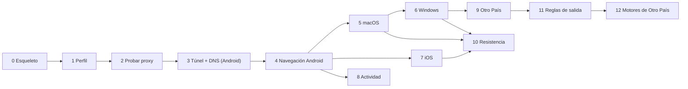

# Roadmap: ProxyUCI por capas verticales

Cada capa vertical entrega **algo que una persona puede usar**, atravesando interfaz, núcleo, adaptador de
plataforma e inyección. Ninguna capa construye una pieza "para más adelante": el núcleo crece solo con lo que la
capa en curso necesita.

Este archivo fija **el orden de entrega y el estado**. Cómo está organizado el código está en
[`docs/architecture.md`](docs/architecture.md); qué hace cada pieza y por qué, en [`PLAN.md`](PLAN.md); las decisiones, en
[`docs/adr`](docs/adr/README.md). Cómo se construyó cada capa, con sus verificaciones y fechas, está en
[`docs/capas`](docs/capas/): el número de cada capa de la tabla enlaza a su documento.

---

## Vista general

| # | Capa vertical | Lo que se puede hacer al terminar | Android | iOS | macOS | Windows |
|---|---|---|---|---|---|---|
| [0](docs/capas/00-esqueleto-andante.md) | Esqueleto andante | Abrir la app y ver en qué plataforma corre | ✔ | ✔ | ✔ | ✔ |
| [1](docs/capas/01-perfil-de-proxy.md) | Perfil de proxy | Crear, editar y guardar un perfil con su contraseña | ✔ | ✔ | ✔ | ✔ |
| [2](docs/capas/02-probar-proxy.md) | Probar proxy | Pulsar "Probar proxy" y saber si las credenciales valen | ✔ | ✔ | ✔ | ✔ |
| [3](docs/capas/03-tunel-con-dns-en-android.md) | Túnel con DNS en Android | Conectar y que los nombres resuelvan | ✔ | | | |
| [4](docs/capas/04-navegacion-en-android.md) | Navegación en Android | Navegar con cualquier app por el proxy | ✔ | | | |
| [5](docs/capas/05-navegacion-en-macos.md) | Navegación en macOS | Lo mismo en el Mac | | | ✔ | |
| [6](docs/capas/06-navegacion-en-windows.md) | Navegación en Windows | Lo mismo en el PC | | | | ✔ |
| [7](docs/capas/07-navegacion-en-ios.md) | Navegación en iOS | Lo mismo en el iPhone | | ✔ | | |
| [8](docs/capas/08-actividad.md) | Actividad | Ver tráfico, estado y registro de eventos | ✔ | ✔ | ✔ | ✔ |
| [9](docs/capas/09-otro-pais.md) | Otro País | Salir por un `.ovpn` encadenado al proxy, opcional por perfil | ✔ | | ✔ | ✔ |
| [10](docs/capas/10-resistencia.md) | Resistencia | Cambiar de red o cerrar mal sin quedarse sin Internet | ✔ | ✔ | ✔ | ✔ |
| [11](docs/capas/11-reglas-de-salida.md) | Reglas de salida | Elegir por sitio o por app si sale por el proxy, por Otro País, directo o se bloquea | ✔ | | ✔ | ✔ |
| [12](docs/capas/12-motores-de-otro-pais.md) | Motores de Otro País | Elegir por perfil OpenVPN o Tailscale para salir por otro país | ✔ | | ✔ | ✔ |

Las marcas ✔ dicen **a qué plataformas aplica** cada capa, no si está terminada: el estado está en «Qué falta».

Las capas 0 a 2 no necesitan ninguna VPN y corren en las cuatro plataformas. Sirven para dejar probados
Koin, el almacenamiento, los sockets y NTLMv2 antes de tocar una interfaz TUN.

---

## Definición de terminado (vale para todas las capas)

- La función se demuestra en un dispositivo o equipo real de cada plataforma marcada.
- Toda clase nueva recibe sus dependencias por constructor; Koin solo aparece en `di/` y en puntos de entrada.
- La prueba `verify()` de los módulos de Koin pasa en los tres targets.
- La lógica nueva del núcleo tiene pruebas comunes con dobles en memoria.
- `./kotlin build` y `./kotlin test` pasan.

---

## Qué falta

Lo que cada capa declara pendiente en su estado; los detalles, en su documento.

| Capa | Pendiente |
|---|---|
| [2](docs/capas/02-probar-proxy.md), [4](docs/capas/04-navegacion-en-android.md), [5](docs/capas/05-navegacion-en-macos.md) | Probarlo contra el proxy real de la UCI; en la 4, además, un dispositivo físico, SOCKS5 como transporte del túnel y sesiones largas |
| [6](docs/capas/06-navegacion-en-windows.md) | La app completa con el aviso de UAC, en una máquina con pantalla |
| [7](docs/capas/07-navegacion-en-ios.md) | Toda la capa: la extensión `PacketTunnel`, que exige un iPhone real |
| [8](docs/capas/08-actividad.md) | El transporte de las estadísticas en iOS, que llega con la 7 |
| [9](docs/capas/09-otro-pais.md) | Comprobarlo en macOS y Windows reales con la red de la UCI |
| [10](docs/capas/10-resistencia.md) | Toda la capa: reconexión al cambiar de red, límites y restauración de rutas y DNS tras un cierre anómalo |
| [11](docs/capas/11-reglas-de-salida.md) | Reglas por app en Windows y macOS, crear reglas desde el registro, plantillas, y que la subred del túnel evite los rangos de la intranet |
| [12](docs/capas/12-motores-de-otro-pais.md) | Probarlo en la red de la UCI con un nodo de salida real, en Android y en escritorio; inicio de sesión interactivo (sin clave) desde el editor |

## Hecho desde la capa 12

Ya está en `master` y no tiene capa propia:

- **Interfaz nueva** con navegación por pestañas y componentes `Uci*`; las capturas de cada pantalla están en
  [`docs/pantallas`](docs/pantallas/README.md).
- **Telemetría y «Consumo»:** tráfico en vivo en Conexión y consumo por día, salida, destino y app, guardado en Room.
- **Cuota de la UCI:** consulta al servicio SOAP, avisos por umbral y pausa del túnel al llegar al límite.
- **Idiomas:** español e inglés, con el idioma elegible en Ajustes.
- **Fallos con motivo y con su arreglo**, y una prueba del proxy antes de decir «Conectado».
- **Red local sin proxy** y el ajuste «Si Otro País se cae, salir por el proxy».
- **Pre-lanzamiento `v1.0.0-rc1`.** Cómo se publica una versión: [`PUBLICAR.md`](PUBLICAR.md).

---

## Después de la versión 1

Cada una es una capa vertical independiente, por prioridad a decidir:

| Capa | Resultado |
|---|---|
| HTTP en claro en la UCI | Páginas `http://` a través de un Squid que rechaza `CONNECT` al puerto 80 |
| Rendimiento TCP | Escalado de ventana y menos contención, si las medidas en dispositivo real lo piden |
| Proxies con TLS | Perfiles HTTPS y SOCKS5 sobre TLS, con fijación de certificado |
| UDP por SOCKS5 | Llamadas y juegos con un proxy `socks5udp` |
| Reglas por app en escritorio | Elegir programas en Windows (`GetExtendedTcpTable`) y macOS (`libproc`), como ya se hace en Android |
| Actividad por app | Ver qué app genera cada conexión, y crear una regla desde ahí |
| Empaquetado | Instaladores firmados para escritorio y publicación en tiendas |
