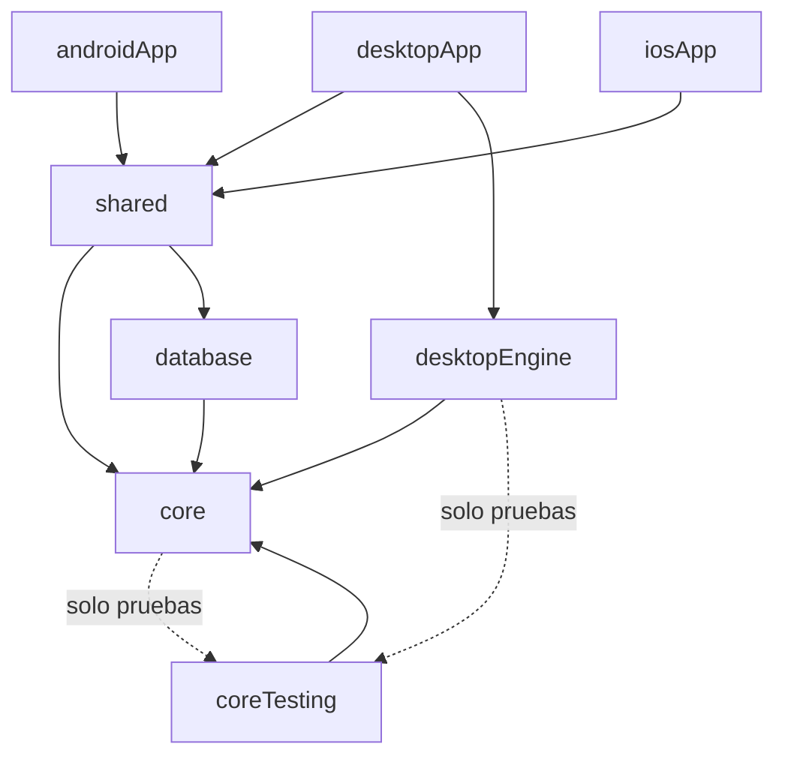
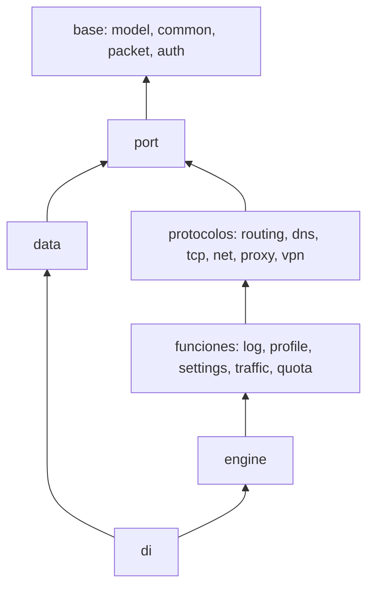

# Arquitectura

Cómo está organizado el código y qué reglas se comprueban solas. Qué hace cada pieza y por qué está así está en
[`PLAN.md`](../PLAN.md); el estado de cada función, en [`ROADMAP.md`](../ROADMAP.md); las decisiones, una a una, en
[`docs/adr`](adr/README.md).

## Módulos

| Módulo | Tipo | Qué contiene |
|---|---|---|
| `core` | `kmp/lib` (jvm, android, iOS) | El motor, sin Compose. Lo enlaza también la extensión de iOS, que tiene un límite de memoria estricto |
| `database` | `kmp/lib` | El registro y el consumo guardados con Room. Aparte de `core` para que la extensión de iOS no cargue SQLite |
| `shared` | `kmp/lib` con Compose | La interfaz: pantallas, view models, `uiModule` |
| `desktopEngine` | `jvm/lib` | Cómo la ventana de escritorio lanza el motor con permisos de administrador y habla con él por un socket local |
| `coreTesting` | `kmp/lib` | Dobles de prueba de `core` y el soporte de las pruebas de Windows |
| `androidApp`, `desktopApp`, `iosApp` | apps | Los puntos de entrada de cada sistema |

`coreTesting` existe porque Amper no tiene *test fixtures*: un módulo no puede usar el código de prueba de otro. Ver
[ADR 0007](adr/0007-modulos-coretesting-y-desktopengine.md).

## Capas de `core`

`core/src` es el código común. Sus paquetes están en capas y **cada una solo puede importar de las de abajo**:

| Capa | Paquetes | Qué hay | Puede importar |
|---|---|---|---|
| base | `model`, `common`, `packet`, `auth` | Datos (`ProxyProfile`, `AppSettings`, `LogEntry`, `UciQuota`…), `AppDispatchers`, paquetes IP y NTLM | nada del proyecto |
| `port` | `port` | Las interfaces hacia fuera: almacenes, repositorios, red, túnel, avisos | base |
| `data` | `data` | Las implementaciones que guardan en esos almacenes (`Stored*`, `EncryptedSecretStore`) | base y `port` |
| protocolos | `routing`, `dns`, `tcp`, `net`, `proxy`, `vpn` | Lo que habla con la red | base, `port` y entre ellos |
| funciones | `log`, `profile`, `settings`, `traffic`, `quota` | La lógica de cada parte de la app | lo anterior, sin `data` |
| `engine` | `engine`, `engine/handler` | Monta el túnel con todo lo anterior | lo anterior, sin `data` |
| `di` | `di` | Lo conecta todo con Koin | todo |

La regla la comprueba `core/test@jvm/architecture/LayersTest.kt`: recorre los `import` y falla si una capa importa de otra
de arriba, o si aparece un paquete sin capa asignada. **Un paquete nuevo hay que registrarlo ahí.** Por qué las capas y no
más módulos: [ADR 0004](adr/0004-capas-de-core.md).

Las implementaciones de cada plataforma están junto a `src/`: `src@android`, `src@jvm` (macOS y Windows),
`src@jvmAndAndroid` (criptografía y TLS que comparten) y `src@ios`. Cada una aporta su `actual val platformModule`.

## Inyección de dependencias

Con Koin, siempre por constructor. Los adaptadores son interfaces (puertos) y el único `expect` del proyecto es
`platformModule`. Reglas:

1. **Todo por constructor.** Nada de `KoinComponent`, `by inject()` ni `get()` fuera de los puntos de la regla 3.
2. **El núcleo depende de interfaces.** Los puertos viven en `core/src/port`; las implementaciones de plataforma, en
   `core/src@<plataforma>`.
3. **Koin solo en la raíz de composición:** los paquetes `di/` y los puntos de entrada que el sistema instancia
   (`Application` y `ProxyVpnService` en Android, la extensión de iOS, `main` en escritorio, `koinViewModel()`).
4. **Lo que necesita datos de ejecución lo crea una fábrica inyectada** (`TunnelEngineFactory`), no Koin.
5. **Sin estado global.** Reloj, aleatoriedad y dispatchers se inyectan.

| Módulo de Koin | Dónde | Qué enlaza |
|---|---|---|
| `platformModule` (`expect`) | `core/src@<plataforma>/di` | Dispatchers, `PlatformInfo`, `Logger`, almacenes, aleatoriedad, criptografía de OpenVPN, direcciones locales |
| `coreModule` | `core/src/di` | Reloj, `LogBuffer`, `TrafficStore`, repositorios, conectores de proxy (con nombre `ProxyConnectors`), `ProxyDialer`, `TailscaleEngine`, `CountryEngineCatalog`, `ProxyTester` |
| `tunnelModule` | `core/src/di` | Solo procesos que ejecutan el túnel: `TunnelRunner`, `TunnelEngineFactory`, `OpenVpnEngine`, `CountryEngines`, `DnsTransport` |
| `databaseModule` | `database/src/di` | Room, `LogHistory`, `TrafficHistory` y sus grabadores |
| `uiModule` | `shared/src/di` | View models, `QuotaMonitor`, el servicio de la cuota |
| `androidAppModule`, `desktopAppModule` | las apps | El `TunnelControl` real de cada sistema |

El túnel corre en un proceso distinto de la interfaz en escritorio (y lo hará en iOS), así que cada proceso arranca su
propio Koin:

| Proceso | Módulos |
|---|---|
| App Android (con `ProxyVpnService`) | `platformModule`, `coreModule`, `databaseModule`, `uiModule`, `tunnelModule`, `androidAppModule` |
| App iOS | `platformModule`, `coreModule`, `databaseModule`, `uiModule` |
| Extensión `PacketTunnel` de iOS (pendiente) | `platformModule`, `coreModule`, `tunnelModule`, sin Compose ni Room |
| Ventana de escritorio | `platformModule`, `coreModule`, `databaseModule`, `uiModule`, `desktopAppModule` |
| Proceso `--engine` de escritorio | `platformModule`, `coreModule`, `tunnelModule` |

Los `single` de Koin son perezosos: un proceso solo crea lo que usa, aunque el módulo declare más. Dos pruebas vigilan el
grafo: `KoinVerifyTest` (dependencias sin enlazar; no ve los registros con nombre, por eso declara a mano los parámetros
`List`) y `CoreGraphTest` (que el catálogo y el túnel compartan el mismo `TailscaleEngine` y `ProxyDialer`).

### Cómo se aplica SOLID

| Principio | En este proyecto |
|---|---|
| Responsabilidad única | Los conectores, los esquemas de autenticación y el relé son clases separadas; `TunnelEngine` solo reparte paquetes |
| Abierto/cerrado | Un `ProxyConnector` por protocolo y un esquema de autenticación por tipo: añadir uno es una clase nueva más una línea en el módulo |
| Sustitución de Liskov | Las pruebas de `TunDevice` corren contra el doble en memoria y, en CI, contra Wintun real |
| Segregación de interfaces | `PacketReader`/`PacketWriter`, `TunnelControl`/`TunnelMonitor`, `SecretStore`/`KeyValueStore`: cada uno ve solo lo que usa |
| Inversión de dependencias | El núcleo define los puertos y las plataformas los implementan; ninguna clase común importa API de plataforma ni Koin |

## La interfaz (`shared`)

Un paquete por pantalla (`connection`, `profile`, `settings`, `usage`, `logs`) más `quota` (la tarjeta y el cliente HTTP de
la cuota), `navigation`, `i18n`, `theme` y `ui` (componentes `Uci*`, iconos y el catálogo). Cada pantalla tiene su
`ViewModel` y recibe sus eventos como contratos `on…` (`ProfileEditorActions`), no el `ViewModel` entero. El editor de
perfil guarda cada sección en un borrador con funciones puras (`RoutingDraft`, `VpnDraft`, `TailscaleDraft`); el
`ViewModel` solo decide cuándo llamarlas. Ver [ADR 0006](adr/0006-borradores-con-funciones-puras.md).

## Pruebas

| Dónde | Qué prueba |
|---|---|
| `core/test` | Lógica común, con dobles en memoria de `coreTesting` |
| `core/test@jvm` | Lo propio de la JVM: red real, Wintun, utun, Llavero; `LayersTest` y `CoreGraphTest` |
| `desktopEngine/test` | La ventana y el motor elevado, de punta a punta con un motor falso |
| `shared/test` | View models y borradores |
| `shared/test@jvm` | Capturas de cada pantalla (`snapshots/`), que sirven de referencia visual |
| `database/test@jvm`, `database/test@ios` | Room (el CI aún no las ejecuta) |

El CI (`.github/workflows/ci.yml`) corre las pruebas de `core`, `desktopEngine` y `shared` en Linux, macOS y Windows, más un
trabajo de Windows con el túnel real. `tools/check_docs.py` comprueba que los documentos no apunten a rutas que ya no
existen.
