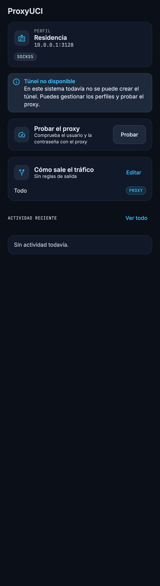
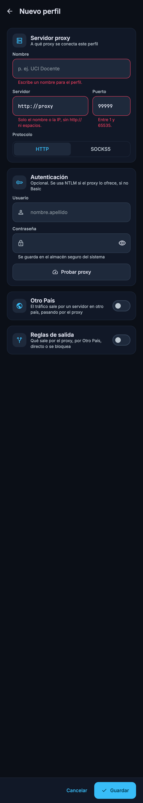
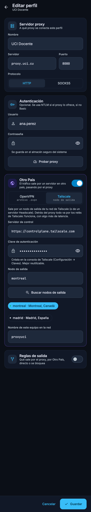
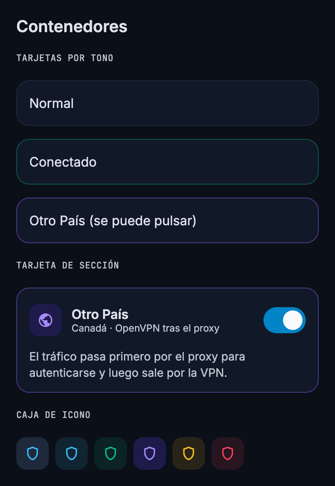
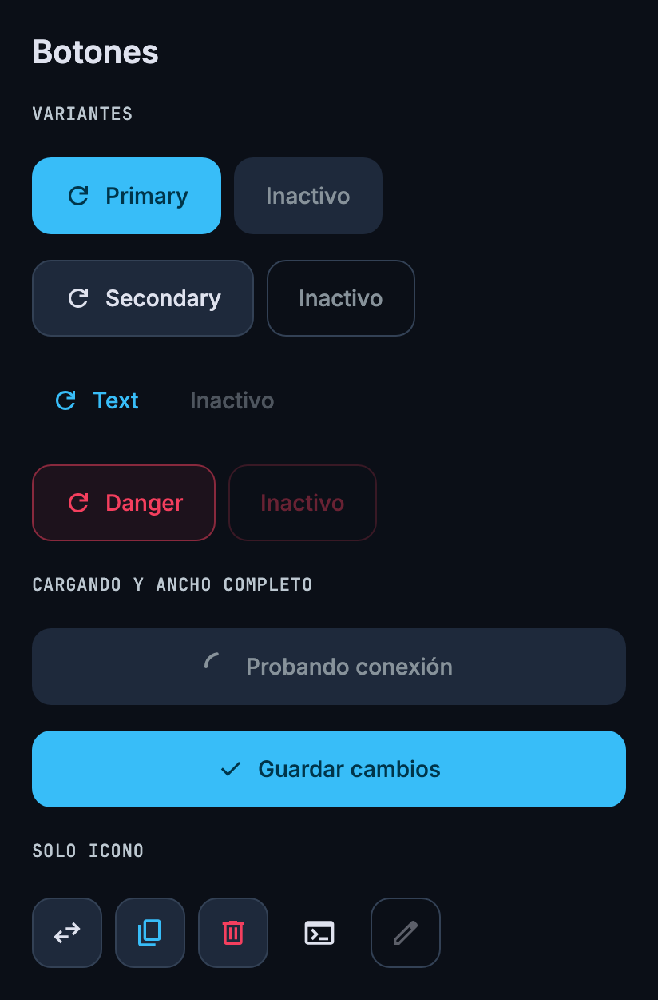
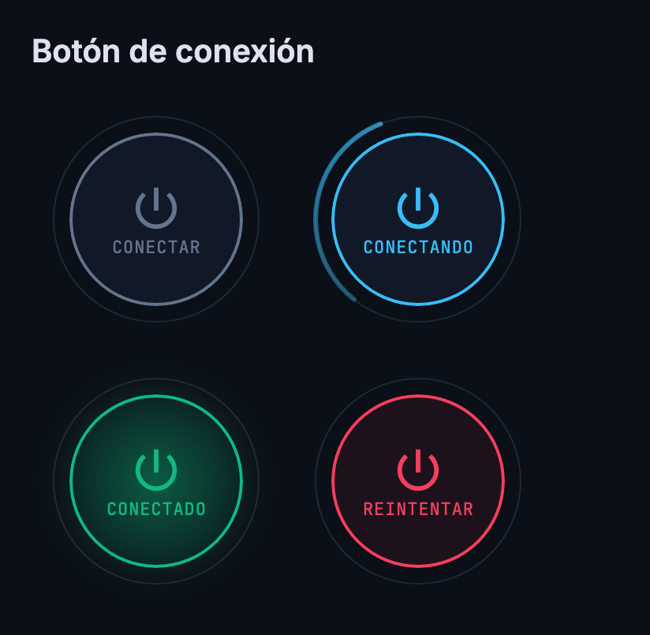
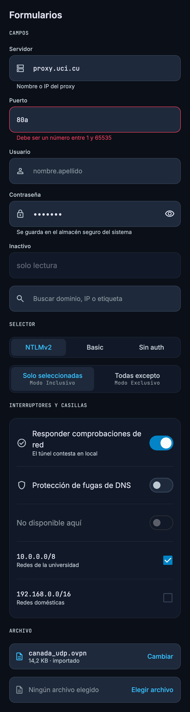
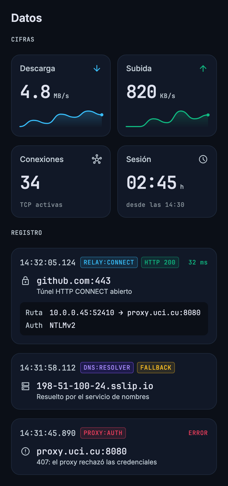

# Pantallas de la nueva interfaz

Capturas de las pantallas rediseñadas, con datos de ejemplo. Son las mismas imágenes que usan las pruebas de capturas
(`shared/test@jvm`), así que siempre muestran el aspecto actual: si una pantalla cambia sin querer, la prueba falla; si
cambia a propósito, se regeneran con:

```
UPDATE_SNAPSHOTS=1 ./kotlin test -m shared -p jvm
```

Están dibujadas en macOS a 412 dp de ancho (móvil) y, cuando aplica, a 1100 dp (escritorio y tableta).

## Conexión (inicio)

| Desconectado | Conectando | Conectado |
|---|---|---|
|  |  |  |

| Otro País caído | Falló | Sin perfiles | Sin túnel (iOS) |
|---|---|---|---|
|  |  |  |  |

Escritorio y tableta (dos columnas, barra lateral):


## Editar perfil

| Perfil nuevo con errores | OpenVPN y reglas de salida | Tailscale con nodos encontrados |
|---|---|---|
|  |  |  |

## Catálogo de componentes

Todos los componentes `Uci` en todos sus estados (en la app: modo desarrollo, pestaña Perfiles → Catálogo).

| Colores y tipografía | Contenedores | Botones | Botón de conexión |
|---|---|---|---|
|  |  |  |  |

| Estado | Formularios | Listas | Navegación | Datos |
|---|---|---|---|---|
|  |  |  |  |  |

## Pendientes de rediseño

Perfiles, Registros y Ajustes todavía tienen el aspecto anterior (con el tema oscuro ya aplicado).
